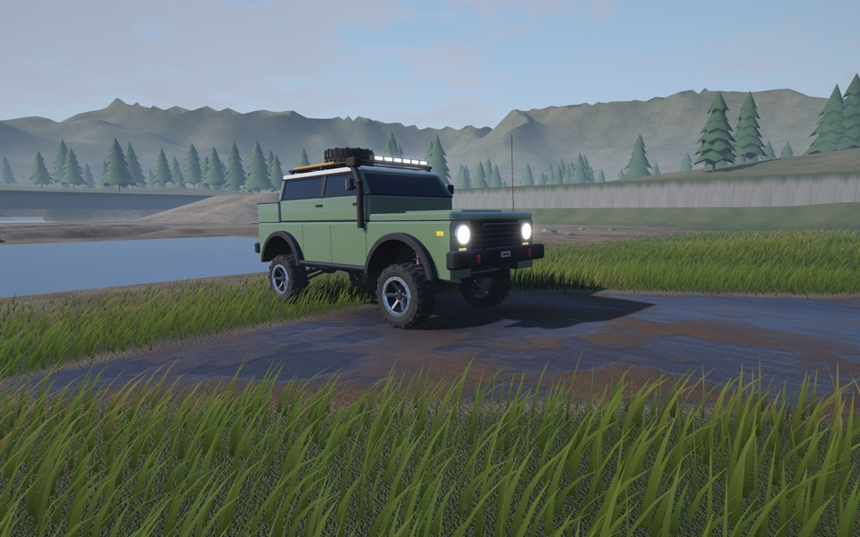

# TrailForge — off-road simulator prototype

A small custom engine in C++20: SDL3 (window, input, gamepad), SDL GPU (rendering via Metal), Jolt Physics
(`VehicleConstraint` + `WheeledVehicleController`), Dear ImGui (diagnostics), GLM. The focus of the prototype is
vehicle behavior: mass, suspension travel, wheelspin, wheel lift, rocks, climbs.

All geometry and textures are procedural. The only external assets are the sounds in `assets/audio/` (Freesound
recordings, see [Audio](#audio) and `assets/audio/CREDITS.md`).



Rendering (Metal only, see [Rendering](#rendering)): PBR, cascaded sun/moon shadows, a time of day (0–24 h, presets,
time-lapse) that drives the sun, sky, fog and ambient light, procedural sky with clouds, a large sun disc and layered
distant mountains, height fog, HDR with ACES tonemapping and bloom, MSAA or FXAA, instanced grass (several species,
flower clusters, a wheat test patch, travelling wind gusts) and pines with LOD, planar puddle reflections, headlights
that light the ground at night. A small mud & puddles showcase meadow sits north of the proving ground.

## Platforms

| Platform | Status |
|---|---|
| macOS 27 / Apple Silicon (arm64), Apple clang 21, Metal | **Run and verified** (everything in "Verification results") |
| macOS, Vulkan through MoltenVK (`SDL_GPU_DRIVER=vulkan`) | Run on the same Mac: `full_check` 210 / 0, captures look like Metal. Not a supported configuration, only a test of the SPIR-V path |
| Windows x64 (MSVC, D3D12 / Vulkan) | Builds and the headless tests pass in GitHub Actions; the package is built there. **Not run on real hardware** |
| Linux x64 (gcc, Vulkan) | Builds and the headless tests pass in GitHub Actions; the packaged app starts and renders on Mesa lavapipe (software Vulkan) under Xvfb. **Not run on real hardware** |

The shaders have one HLSL source compiled at build time to SPIR-V, MSL / metallib and (on Windows) DXIL, see
[Shader pipeline](#shader-pipeline). The renderer takes the first format the SDL GPU device accepts, in the order
metallib, MSL, DXIL, SPIR-V. GPU frame timing exists only on Metal; elsewhere the UI shows `GPU n/a`.

Trying Windows or Linux (please report what happens):

1. Download the package from the GitHub release (`TrailForge-<version>-windows-x64.zip` or `...-linux-x64.tar.gz`),
   extract it and keep `assets/` next to the executable. Windows: SmartScreen warns about an unsigned executable
   ("More info" → "Run anyway"). Linux: a Vulkan driver is needed (Mesa RADV / ANV / NVK or the NVIDIA driver).
2. `trailforge --version` and `trailforge --paths` (asset directory and user data directory) in a terminal.
3. Start `trailforge`; the console prints `GPU driver '<d3d12|vulkan>', shaders: <DXIL|SPIR-V>`. Check that the
   picture looks like the macOS screenshots (sky, shadows, grass, puddle reflections, no upside-down image).
4. Drive (W/S, A/D, Space, R), press F1, change Graphics → quality presets, and listen for the engine and tire
   sounds.
5. From a source checkout, `trailforge --script tools/scenarios/full_check.txt --no-audio` must end with
   `0 failed`; the console log and the exit code are the most useful report. Windows: try
   `SDL_GPU_DRIVER=vulkan` as well.

## Prerequisites

- macOS: Xcode Command Line Tools with the Metal toolchain (`xcrun -sdk macosx -f metal` must find the compiler).
  Without it the build still succeeds: the shaders are compiled from the embedded MSL source at startup.
  CMake ≥ 3.24 and Ninja: `brew install cmake ninja`.
- Windows: Visual Studio 2022 or newer with the C++ x64 tools (MSVC), CMake ≥ 3.24 and Ninja (both ship with
  Visual Studio); configure from an "x64 Native Tools" prompt.
- Linux: gcc or clang with C++20, CMake ≥ 3.24, Ninja and the SDL3 build dependencies (on Ubuntu:
  `libx11-dev libxext-dev libxrandr-dev libxcursor-dev libxfixes-dev libxi-dev libxss-dev libxtst-dev
  libxkbcommon-dev libwayland-dev wayland-protocols libegl1-mesa-dev libdrm-dev libgbm-dev libasound2-dev
  libpulse-dev libudev-dev libdbus-1-dev`, the list used in `.github/workflows/ci.yml`).
- Internet access for the first configure. Dependencies are downloaded via FetchContent as archives
  of exact commits with SHA256 verification:

| Dependency | Version | Commit |
|---|---|---|
| SDL | release-3.4.18 | `829a65d7` |
| Jolt Physics | v5.6.0 | `e77f1755` |
| Dear ImGui | v1.92.9b | `f1cc2ae1` |
| GLM | 1.0.3 | `8d1fd52e` |
| miniaudio | 0.11.25 | `9634bedb` |
| SPIRV-Headers, SPIRV-Tools, glslang, SPIRV-Cross (shader compiler, host tool only) | Vulkan SDK tag vulkan-sdk-1.4.357.0 | `29981f65`, `9a49b088`, `168d452a`, `6c09849f` |
| DXC (prebuilt, Windows hosts only) | v1.9.2609 | release zip `dxc_2026_09_29.zip` |

## Build and run

```sh
cmake --preset release
cmake --build --preset release
./build/release/trailforge

# debug build (SDL GPU debug layer enabled)
cmake --preset debug && cmake --build --preset debug && ./build/debug/trailforge

# tests
ctest --preset release        # or debug

# physics + tests only, without SDL/rendering
cmake --preset headless && cmake --build --preset headless && ctest --preset headless

# Windows (x64 Native Tools prompt) and Linux; presets only show up on their host system
cmake --preset windows-release && cmake --build --preset windows-release && ctest --preset windows-release
cmake --preset linux-release && cmake --build --preset linux-release && ctest --preset linux-release
# (windows-debug / linux-debug likewise)
```

`trailforge --paths` prints the asset lookup directories and the user data directory (`SDL_GetPrefPath`, e.g.
`~/Library/Application Support/TrailForge/`, `%APPDATA%\TrailForge\`, `~/.local/share/TrailForge/`; reserved for
future settings, nothing is written there yet except the empty directory that SDL creates).

App icon (`external_assets/images/Icon.png`, macOS): the build converts it with `sips` to a 256×256 BMP that is embedded into the binary;
at startup `SDL_SetWindowIcon` sets it (on Cocoa this is `NSApp.applicationIconImage`, i.e. the Dock icon of the
running `trailforge` process), masked to the macOS rounded-square grid. `Logo.png` is reserved for a future menu
and is not loaded at runtime.

The build also produces `build/<preset>/TrailForge.app`, a self-contained bundle: a copy of the executable,
`Info.plist` (version from `project(TrailForge VERSION …)` in `CMakeLists.txt`, `LSMinimumSystemVersion` = the
deployment target, i.e. the SDK version 27.0 unless `CMAKE_OSX_DEPLOYMENT_TARGET` is set), `TrailForge.icns`
(`sips` + `iconutil`, 16–1024 px) and the runtime assets in `Contents/Resources/assets/audio`. Shaders and the
window icon are embedded in the binary, so the sounds are the only files read at runtime. They are looked up via
`SDL_GetBasePath()` (SDL 3.4.18 on macOS: `Contents/Resources/` inside a bundle, the executable's directory
otherwise): `<base>/assets/audio`, then, in development builds only, `<base>/../../assets/audio` and the source
tree. The version is shown in the window title, the HUD and the Telemetry window, and by `trailforge --version`.

### Packaged build and release

```sh
tools/release/package_macos.sh            # -> dist/TrailForge.app and dist/TrailForge-<version>-macos-arm64.zip
tools/release/package_macos.sh --publish  # the same, then gh release create v<version> with docs/releases/v<version>.md
```

The script does a clean Release configure in `build/package` with `-DTRAILFORGE_PACKAGED=ON` (no source-tree
asset fallback), builds, runs CTest, copies the bundle to `dist/`, checks that `otool -L` lists only system
libraries and frameworks, signs ad hoc (`codesign --force --deep -s -`) and verifies the signature, zips with
`ditto -c -k --keepParent`, then runs the bundle from `/` and from a fresh unzip and checks that all 55 sounds load
from inside the bundle. `dist/` is git-ignored. The app is not notarized: after downloading, open it with
right-click → Open, or `xattr -dr com.apple.quarantine TrailForge.app`. Releases are on GitHub
(`gh release list`); release notes live in `docs/releases/`.

Windows and Linux packages are built by CI (`.github/workflows/ci.yml`) and can be built locally the same way:

```sh
tools/release/package_linux.sh [--smoke-window]               # -> dist/TrailForge-<version>-linux-<arch>.tar.gz
pwsh tools/release/package_windows.ps1 [-SmokeWindow]         # -> dist/TrailForge-<version>-windows-x64.zip
```

Both do a clean packaged Release build in `build/package`, run CTest, put the executable, `assets/` (audio, music, fonts, images) and a
`README.txt` into `dist/TrailForge-<version>-<os>-<arch>/`, archive it, extract the archive into a temporary
directory and check from another working directory that `--version` matches, that `--paths` reports exactly one
sound asset directory, the one inside the package, and that its music directory has `intro.mp3`. The optional window smoke test needs a GPU (CI runs the Linux package
on lavapipe in a separate step instead).

Command-line options:

- `--no-intro` — skip the intro and go straight to the start menu (scripts and `--demo` start in gameplay);
- `--no-ui` — start with diagnostics hidden;
- `--demo` — scripted drive without input;
- `--quit-after N` — quit automatically after N seconds (smoke test);
- `--capture file.bmp|file.png [--capture-at N]` — save one rendered frame;
- `--script file.txt` — scenario mode (see below). Exit code 1 if any check failed;
- `--vehicle ID` — start with catalog vehicle ID (`assets/vehicles/ID`, e.g. `trailforge_ev`), remembered like a
  choice on the vehicle page (not in scenario mode);
- `--no-audio` — no audio device, no sounds loaded;
- `--audio-capture out.wav` — render the mix offline into `out.wav` (no device, see [Audio](#audio));
- `--paths` — print the asset lookup directories (`assets:` sounds, `music:`, `fonts:`, `images:`) and the user data
  directory, then exit;
- `--version` — print the version and exit.

`build/<preset>/trailforge_probe` — headless measurements:
- `brake`, `course`, `bench` — braking, course drive, step cost at 60/120/240 Hz;
- `corner [steer] [collisionSteps]` — steady-state cornering on a flat pad, average loads;
- `demo` — loads along the `--demo` trajectory in 1 s windows (Σload, Σ(F·ŷ), bump stop hits);
- `hillbrake` — holding on climbs with the brake;
- `susp [feature throttle low secs steer]` — per-wheel suspension length, compression and hub height in body space
  over a track feature (default 2, the diagonal twister), body-terrain contact ticks;
- `compare` — the EV vs SUV table: launch, brake 50-0 / 100-0 with and without ABS (regen share), lift-off, corner,
  climbs on dirt 20° and mud 15° per drive mode, the twister, steady-speed energy (electric only);
- `skid` — tire slip, squeal and mark response for launches, brakes and turns on the surface lanes and a flat pad;
  `launch [lane throttle]` — the same per tick for one launch (`PROBE_LOW_RANGE`, `PROBE_HZ`,
  `PROBE_NO_STATIC_GRIP`, `PROBE_NO_CLUTCH_LIMIT` in the environment); `showcase` — where the skid layer is audible
  on a scripted drive around the mud showcase; `squeal` — squeal peak, output level, length and tail after the slide
  for gentle / full launches, light, moderate, tapped, full and ABS braking and handbrake / power slides on concrete,
  dirt and the flat pad (the mixer has only the two squeal sounds, as sines of the real lengths; `PROBE_TRACE=<case>`
  prints the per-wheel slip); `skid` also lists the wheel-seconds of squeal per surface under the wheel;
  `keyboard` — instant W / S (1.0 at once) against the keyboard pedal ramp (`src/input/KeyboardPedals.h`): held W
  launch, 0.15 / 0.25 / 0.4 s S taps and a held S at 50 km/h on the concrete lane and the flat pad (slip, sliding
  time, marks, 0-30 km/h, stopping time and distance); `launchmarks` — rubber laid by gentle / keyboard / hard /
  full-pedal launches in 2H and 4H and by 1 / 2 / 5 s stationary burnouts on the concrete lane (ribbon length, peak,
  mean, dark length and width; burnout stamps composited per spot);
- `surfaces` — effective friction per surface: full-throttle launches (high and low range) and 50 km/h stops on six
  flat surface lanes, rolling climbs and hill starts on 15° / 20° ramps of every surface (`TrackLayout::SurfaceRamps`,
  headless only); `climb [lane]` — the force balance of one ramp climb;
- `abs [0|1]` — 50 and 100 km/h full stops on the concrete, rock, dirt, sand, grass and mud lanes, straight and with
  40 % steer, ABS off / on: distance, heading after 1 s, locked wheel-seconds, ABS cycle rate (steered runs are cut
  when the vehicle leaves its lane); the argument sets the friction ellipse off / on;
- `ellipse` — friction ellipse off / on: steady cornering at 30 / 60 / 100 % steer on concrete, dirt and mud
  friction, full-throttle launches on five lanes;
- `tc` — flat high-range launches and ramp hill starts with TC off / on / off-road (`TF_TC_TRACE=1` prints a trace);
  `tcmud` — the 15° mud hill start at 60 / 120 / 240 Hz from three creep points per TC mode;
- `diff` — differential configurations on `TrackLayout::SlopeWithWheelPit` (headless only) and the diagonal twister
  (`TF_DIFF_TRACE=1` prints a trace).

### Scenario mode

`./build/release/trailforge --script tools/scenarios/full_check.txt` — full window and rendering.
Input takes the same path as a live player's: the scenario pushes keyboard, mouse and wheel events
into the SDL queue (`SDL_PushEvent`), `Input` processes them, and they reach the physics on ticks.
`Input` tracks held keys from events rather than from `SDL_GetKeyboardState`,
so synthetic and real key presses are handled identically.

One command per line, `#` starts a comment:

| Command | What it does |
|---|---|
| `down/up/tap KEY` | press / release / press and release (SDL name: `W`, `Space`, `Escape`, `Left`…) |
| `wait S` | pause for S seconds of real time |
| `until VAR OP VAL TIMEOUT` | wait for a condition (`< <= > >= == !=`); FAIL on timeout |
| `expect VAR OP VAL` | check immediately |
| `mark VAR` | remember a value; afterwards `d_VAR` = current − remembered |
| `teleport N` / `resize W H` / `capture file.png` | teleport to point N, `SDL_SetWindowSize`, save a frame |
| `click KEY` / `inputclick KEY` / `scrollto KEY` / `text STR` | click an ImGui widget, Cmd+click (number input), scroll the Tuning window to a widget, type text |
| `orbit DX DY` / `wheel DY` | camera orbit with the right mouse button / mouse wheel |
| `log NAME` / `reset_stats` / `quit` | telemetry line to stdout / reset min/max counters / quit |
| `quality Low\|Medium\|High\|Ultra` | apply a graphics preset |
| `set KEY V` | graphics/look setting: `render_scale`, `msaa`, `fxaa`, `cascades`, `shadow_size`, `shadow_dist`, `shadow_filter`, `reflections`, `refl_scale`, `bloom`, `grass`, `grass_dist`, `flowers` (0..1), `grass_detail` (0/1), `clouds`, `exposure`, `fog`, `auto_reverse` (0 — S only brakes), `tod` (hours), `sun_heading` (deg), `tod_speed` (h/s), `tod_run` (time-lapse 0/1), `mud`, `auto_mud`, `headlights`, `debug_lines`, `ui`, `hud`, `graphics_ui`, `vsync`; tire marks: `marks` (draw 0/1), `marks_gen` (generate 0/1), `marks_max` (ring capacity), `marks_fade` (s), `marks_gain` (all surfaces), `marks_clear 1`, `marks_fill 1` (synthetic fill to the cap); wheel spray: `spray` (0/1), `spray_max` (cap), `spray_dust` (0/1), `spray_clear 1`, `spray_fill 1` (synthetic fill to the cap around the vehicle); body mud: `body_mud V` (wet coat V on every region), `body_mud_clear 1` |
| `time Dawn\|Noon\|Sunset\|Night\|HOURS` | set the time of day (preset or 0–24 h); stops the time-lapse |
| `camera X Y Z TX TY TZ` / `camera follow` | free camera at a pose looking at a target / back to the follow camera |
| `wheels R W` | tire radius and width (m) on both axles, as a tire kit would set them; rebuilds the vehicle in place (`tools/scenarios/wheel_fit.txt`) |
| `camera vehicle side\|top\|front\|rear\|three_quarter\|three_quarter_rear\|roof [DIST] [FOV]` | free camera in the vehicle frame at DIST m (default 30) with FOV degrees (default: 6 m tall view); far + narrow = near-orthographic views (`tools/scenarios/car1_views.txt`) |
| `menu intro\|main\|start\|pause\|resume\|settings\|back` | jump the menu flow: play the intro, open the start menu (its world and camera), start gameplay, open / close the pause menu, open Settings, go back one page |
| `menu select ITEM` / `click menu:ITEM` | move the menu cursor to an item (no sound) / click it with the mouse through the SDL queue. Items: `start`, `settings`, `quit`, `resume`, `restart`, `quit_to_menu`, `quit_game`, `quality`, `render_scale`, `vsync`, `master`, `music`, `effects`, `ui`, `abs`, `tc`, `diff`, `auto_reverse`, `controls`, `drive_keys`, `pad_glyphs`, `back` |
| `controls keyboard mac\|pc\|native` / `controls pad_type none\|xbox\|ps4\|ps5\|switch\|unknown\|real` | Controls page captures only: force the key cap wording / stand in for the connected pad seen by the automatic button names (not persisted) |
| `menu garage` / `menu garage_close` | open the garage (from the start or the pause menu) / close it |
| `garage set KEY V` / `garage step KEY ±1` / `garage row KEY` | set a garage parameter (stored units, clamped) / step it / move the cursor to its row (`vehicle`, `setup`, `kit` or a parameter key) |
| `garage save` / `save_new` / `rename NAME` / `delete` / `select NAME\|factory` / `reset` / `kit ID\|none` / `vehicle ID` | setup operations of the garage model |
| `click garage:ROW[:F]` | click a garage row through the SDL queue (ROW: a parameter key, `vehicle`, `setup`, `kit`, `save`, `save_new`, `rename`, `delete`, `reset`, `back`); `:F` clicks a slider at fraction F (0..1) |
| `click modal:confirm` / `click modal:cancel` | click a button of the open modal dialog through the SDL queue |
| `transfer 2h\|4h\|4l` | select a transfer case mode (part-time 4WD) |
| `pedal throttle\|brake V` | hold an analog pedal at V (0..1) like a gamepad trigger (not ramped; max with the keys) until set to 0 |
| `perf_begin LABEL` / `perf_end` | collect frame times; prints `PERF LABEL fps frame_avg p95 p99 max cpu_avg gpu_avg …` |
| `vehicle ID` / `soc V` | choose a catalog vehicle as the vehicle page does (respawns in place on the next tick; not saved in scenario mode) / set the battery state of charge of an electric vehicle (0..1) |
| `menu vehicles` / `click vehicle_card:N` | open the vehicle page from the start menu / click vehicle card N through the SDL queue |

Scenarios start in gameplay (no intro, no menu) and never read or write the settings file; garage setups go to
`<tmp>/trailforge_scenario_setups`, emptied at start.

Other scenarios: `tools/scenarios/controls.txt` (Controls page: drive keys, gamepad button names auto / override,
no overlapping callouts, wheel scroll, values kept, then a drive with the arrow keys including the pedal ramp;
`/tmp/trailforge_controls_*.png`), `tools/scenarios/menus.txt` (intro, start menu, Settings, Controls, the blurred pause menu, reset
and quit to the start menu through keys and mouse clicks; the pause freezes ticks and position;
`/tmp/trailforge_menu_*.png`), `tools/scenarios/visual_tour.txt` (showcase screenshots `/tmp/trailforge_vis_*.png`),
`tools/scenarios/time_of_day.txt` (Dawn/Noon/Sunset/Night and a banner-like sunset view, `/tmp/trailforge_tod_*.png`),
`tools/scenarios/perf_presets.txt` (frame times per quality preset),
`tools/scenarios/grass_look.txt` (grass, flowers and wheat at noon and sunset, close-up and wide, flattened lanes in
the meadow and the wheat, overview per preset; `/tmp/trailforge_grass_*_after.png`),
`tools/scenarios/tracks.txt` (tire marks on concrete, dirt, mud and grass, `/tmp/trailforge_tracks_*.png`, and the
cost of the marks with the ring empty and filled to 16k / 64k segments),
`tools/scenarios/launch_marks.txt` (2H full-pedal launch, 2 s and 5 s burnouts on concrete with analog `pedal`
input, `/tmp/trailforge_launchmarks_*.png`),
`tools/scenarios/garage.txt` (garage from the pause and the start menu: keyboard, mouse slider click, rebuild in
place, RWD layout, save / typed rename / save as new / select / delete / reset, `/tmp/trailforge_garage_*.png`),
`tools/scenarios/audio_check.txt` (the situations the sound reacts to, checks the mixer parameters; run it with
`--audio-capture`, see [Audio](#audio)),
`tools/scenarios/suspension.txt` (stops on the diagonal twister with a wheel in the air; follow view with the HUD,
rear and side views, `/tmp/trailforge_v_susp_*.png`),
`tools/scenarios/tread_dirt.txt` (soil printed onto concrete after the mud bath and the sand, rolling and with
wheelspin, top-down `/tmp/trailforge_tread_*.png`),
`tools/scenarios/spray.txt` (wheel spray: nothing while rolling calmly, wheelspin on mud, dirt, sand and grass, a
puddle crossing, a locked-wheel slide, the cap; `/tmp/trailforge_spray_*.png`),
`tools/scenarios/spray_look.txt` (rear 3/4 view of mud wheelspin, body mud after 5 s of wheelspin, sand and grass
spray and wheel close-ups; `/tmp/trailforge_spray2_*.png`),
`tools/scenarios/skid_profile.txt` (a 65 km/h locked-wheel stop on the skid strip, top-down
`/tmp/trailforge_skid_profile*.png`),
`tools/scenarios/skid_check.txt` (tire squeal gating: silent for normal launches and turns on concrete, short for a
brake tap, audible for lock-up and handbrake slides, never while the mud layer is active; needs the mixer, i.e. a device or `--audio-capture`),
`tools/scenarios/ev_check.txt` (electric vehicle: vehicle page with keys, mouse wheel and card clicks, launch, lift-off
regen, blended braking, SoC and energy counters, drive modes, the low range message, reverse, an empty battery, the
mud bath in OFF-ROAD; `/tmp/trailforge_ev_*.png`), `tools/scenarios/ev_audio.txt` (EV launch, regen and stop for an
`--audio-capture` analysed by `tools/audio/analyze_capture.py`), `tools/scenarios/car2_views.txt` (EV model views
for comparison with Cars.png car #2, `/tmp/trailforge_car2_*.png`).

Variables: `speed_kmh`, `fwd_kmh`, `gear`, `rpm`, `dir`, `low`, `tilt`, `x/y/z`, `ticks`, `paused` (1 while the
simulation does not tick: pause menu or debug freeze), `frozen` (debug freeze, P), menus: `menu_screen` (0 intro,
1 start menu, 2 playing, 3 paused, 4 garage), `menu_page` (0 start, 1 pause, 2 Settings, 3 Controls, 4 vehicle page), `menu_depth`,
`menu_cursor`, `menu_scroll` / `garage_scroll` (list offset in px), `menu_fade` (start menu fade-in 0..1), `menu_blur` (0..1), `menu_font`, `menu_logo` (assets loaded),
`setting_<key>` (the persistent settings: `quality`, `render_scale`, `vsync`, `master`, `music`, `effects`, `ui`,
`abs`, `tc`, `diff`, `auto_reverse`, `drive_keys`, `pad_glyphs`, `vehicle` (catalog index of the remembered choice)), `settings_roundtrip` (1 if the settings file format
keeps every current value), controls: `drive_keys` (applied to the input: 0 W A S D, 1 arrows), `kb_style` (0 Mac,
1 PC), `pad_glyphs` (resolved: 0 Xbox, 1 PlayStation), `controls_callouts` / `controls_overlaps` (callouts on the
Controls page and overlapping pairs of callouts, key caps and controller outline, measured with the real font), garage: `garage_open`, `garage_cursor`, `garage_dirty`, `garage_setups`,
`garage_factory`, `garage_renaming`, `garage_modal` (0 none, 1 rename, 2 delete, 3 reset), `garage_modal_error`,
`garage_rename_len`, `garage_pending`, `garage_rate_front` / `garage_rate_rear` (wheel rate N/mm
shown next to the spring frequency), `garage:<key>` (the garage's value of a setup parameter),
`cfg:<key>` (the same parameter read from the running vehicle), `text_input` (SDL text input active), drivetrain:
`layout` (0 RWD, 1 FWD, 2 AWD, 3 part-time, 4 on-demand), `transfer` (0 2H, 1 4H, 2 4L), `front_driven`,
`rear_driven`, vehicles: `vehicle_index` (catalog index of the running vehicle, 0 = default), `vehicle_choice` (the
vehicle page's choice), `vehicle_cards` (cards drawn), `electric`, `direction` (0 drive, 1 reverse), electric drive:
`soc` (0..1), `motor_kw` (both motors, negative = regen), `battery_kw` (with the auxiliary load), `motor_nm_f` /
`motor_nm_r`, `motor_rpm_f` / `motor_rpm_r`, `regen` (0/1), `ev_mode` (0 NORMAL, 1 OFF-ROAD), `ev_front_share`,
`energy_out_kwh` / `energy_in_kwh` (battery energy out / in since the spawn),
`cam_free`, `ui_visible`, `ui_kb`, `ui_text`, `static_grip`, `clutch_limit` (Tuning toggles as applied to the vehicle), `air`, `max_air`, `lowgrip_wheels`, `max_slip`, `load_sum`,
`min_cam_clearance`, `front_spring`, `mass`, `depth_w/h`, `depth_creations`, `depth_matches_window`,
`auto_reverse`, `hint` (1 while the driving hint is on screen), driver aids: `abs` (0/1), `tc` (0 off, 1 on,
2 off-road), `diff_locks` (0–3), `front_diff` / `center_diff` / `rear_diff` (effective mode: 0 open, 1 LSD,
2 locked), `abs_seen` / `tc_seen` (the aid acted in a sampled frame since `reset_stats`), `max_locked` (most locked
wheels in one frame) and `lock_time` (locked wheel-seconds; locked = in contact, ground speed > 2 m/s, wheel surface
speed below 20 % of it),  `win_w/h`, `px_w/h`, `fps`, `frame_ms`, `cpu_ms`, `gpu_ms`, `quality`, `msaa`, `render_w`, `draw_calls`,
`grass_blades`, `reflection`, `mud`, `tod`, `tod_run`, `sun_el`, `sun_az` (deg), `trees`, `marks` (live segments),
`marks_cap`, `marks_written`, `marks_drawn`, `marks_us` (CPU per tick), `marks_s<N>` (live segments on SurfaceId N:
0 Concrete, 1 PackedDirt, 2 Rock, 3 LowGrip, 4 Mud, 5 Grass, 6 Sand), `tread_soil_max` (most soil on any tread, 0..1),
`spray` (live spray particles), `spray_emitted`, `spray_drawn`, `spray_max`, `spray_fine` (share of fine bits),
`body_mud_max`, `body_mud_<region>` (`arch_rear_<w>`, `arch_front_<w>`, `behind_<w>` with `w` = fl/fr/rl/rr,
`rear_bumper`, `front_bumper`), `wheel_width_r`, `wheel_visual_radius_r` / `wheel_visual_width_r` (measured rear
wheel mesh), `wheel_fit_err` (largest mesh vs physics radius / width difference over both axles, m),
`msg:<substring>` (1 if the latest UI message contains the substring),
audio: `audio_active`, `audio_t` (captured seconds), `audio_src_rpm`, `audio_load`, `audio_skid`, `audio_gravel`,
`audio_dirt`, `audio_mud`, `audio_grass`, `audio_wind`, `audio_motor_hz` (electric motor order), `audio_motor`,
`audio_inverter`, `audio_road` (mixer levels), `audio_day`, `audio_night`, `audio_gameplay` (gain of the
gameplay sounds, 0 while paused), `audio_music` (music bus gain 0..1), `audio_music_t` (seconds of music played), `audio_voices`, `audio_oneshots`, `audio_peak_db`, `audio_clipped`, `audio_cpu`, `audio_ev<N>` (events
received by the mixer: 0 engine start, 1 gear, 2 bump stop, 3 suspension thump, 4 body impact, 5 splash, 6 creak,
7 UI), and more. Full list: `Application::scenarioValue`.
Driver aid `set` keys: `abs 0/1`, `tc 0/1/2`, `diff_locks 0..3`.
Audio `set` keys: `audio_ui` (panel 0/1), `audio_mute`, `audio_master`, `audio_pitch`, `audio_whine`, `audio_motor`,
`audio_play_ui N` (play UI sound N: 0 click, 1 hover, 2 confirm, 3 back, 4 slider tick, 5 menu open, 6 menu close).

## Controls

| Action | Keyboard | Gamepad |
|---|---|---|
| Throttle / brake (stopped: release S and press again for reverse; keys ramp, see below) | W / S (or ↑ / ↓) | RT / LT |
| Steering | A / D (or ← / →) | left stick |
| Handbrake | Space | A (South) |
| Forward ↔ reverse, manual (only below 1 m/s) | Q | X (West) |
| Low range (only below 1 m/s; part-time 4WD: 4H ↔ 4L, from 2H to 4L; electric: none, a message says so) | L | Y (North) |
| Transfer case 2H → 4H → 4L (part-time 4WD only; 4L in / out only below 1 m/s); electric: drive mode NORMAL ↔ OFF-ROAD | V | D-pad left |
| Reset to the last start point | R | Back / View |

Keyboard pedals are a driver-input model (`src/input/KeyboardPedals.h`, the constants are in `KeyboardPedalSettings`),
not a force: a held W goes to 0.5 within 0.15 s and to 1.0 after 0.8 s, a held S to 0.4 within 0.1 s and to 1.0
after 0.7 s; releasing the key drops the pedal at once. A key is on/off, so without a ramp every tap was a full
pedal: the 2H SUV spun its rear wheels on every keyboard launch and locked them on every short brake tap. Measured
(`trailforge_probe keyboard`, concrete lane, instant → ramp): held W max slip 4.80 → 0.92 m/s, sliding 2.23 → 0 s,
marks 0.77 → 0, 0-30 km/h 1.90 → 1.73 s; a 0.25 s S tap at 50 km/h 7.57 → 1.17 m/s, marks 0.77 → 0; a held S stops in
1.83 s / 14.5 m instead of 1.75 s / 13.5 m and still locks the rear wheels (equal front / rear brake torque); a
0.4 s tap (pedal 0.66) still locks them. Gamepad triggers are analog and not ramped; scenarios that set pedal values
directly bypass the ramp.
| Camera: follow ↔ free | C | RB |
| ABS on / off | B | D-pad up |
| Traction control: off → on → off-road | T | D-pad right |
| Diff locks: open → rear → rear + center → all | X | D-pad down |
| Headlights | H | — |
| Diagnostics | F1 | — |
| Graphics panel (quality, look, cosmetic dirt) | F2 | — |
| Audio panel (volumes, mute, engine pitch, read-outs) | F3 | — |
| Pause menu (Resume, Reset vehicle, Garage, Settings, Quit to main menu, Quit game) | Escape | Start / Menu |
| Debug freeze (physics stops, no menu) / single physics step while frozen | P / N | — |
| Camera orbit / zoom | RMB + mouse / wheel | — |
| Free camera | the cluster that does not drive (arrow keys with W A S D driving, W A S D with the arrows), PgUp/PgDn, Shift — faster | — |
| Menus: select / back | Enter (Return on a Mac) / Esc or Backspace (Delete on a Mac) | A (South) / B (East) |

**Drive keys.** Settings → Controls → DRIVE KEYS chooses the driving cluster: W A S D (default) or the arrow keys. The
other cluster moves the free camera; no other binding uses either cluster, so nothing clashes (CTest
`controls_layout` checks that every key is bound once in both layouts). The keyboard pedal ramp applies to whichever
keys drive. The HUD hint line follows the choice. The menus accept both clusters for navigation in either layout.
The table above names the W A S D layout.

**Controls page.** Below DRIVE KEYS a vector-drawn keyboard shows only the bound keys, in their ANSI positions (function
row, letters, Space, Shift, Return, Backspace, PgUp / PgDn, the inverted-T arrows, and the mouse), each with a callout;
the driving keys are drawn bold. Key cap wording follows the platform the game runs on (macOS: RETURN, DELETE, PAGE UP;
Windows / Linux: ENTER, BACKSPACE, PG UP); there is no switch for it. Below GAMEPAD BUTTONS a drawn controller shows
every bound control with a callout. Button names come from the connected pad (`SDL_GetGamepadType`: PS3 / PS4 / PS5 ->
PlayStation names and shapes — cross, circle, square, triangle, L1 / R1 / L2 / R2, Create / Options; everything else,
and no pad, -> Xbox names A / B / X / Y, LB / RB / LT / RT, View / Menu); AUTO can be overridden with XBOX or
PLAYSTATION. Nintendo pads get Xbox names, which do not match their printed letters. No gamepad has been connected to
this build: the pad diagram, the automatic choice with a real pad and the gamepad bindings are untested on hardware
(CTest `pad_glyph_detect` covers the type mapping only). Bindings, key labels and glyph names live in
`src/input/ControlLayout.h` (no SDL); `Input` maps them to SDL keys and buttons.

**Menus.** The game starts with an intro (logo over `intro.mp3`; any key, click or gamepad button skips it), then
the start menu: Start, Garage, Settings, Quit. Up / Down (arrows, W / S, D-pad or left stick) move, Enter / Space / gamepad A
select, Left / Right (A / D, D-pad, stick) change a setting, Esc / Backspace / gamepad B go back; the mouse hovers and
clicks rows (clicking the arrows of a setting steps it down / up). Esc during play opens the pause menu. Settings
(shared by both menus): graphics preset, resolution scale, VSync, master / music / effects / UI volume, the driver
aid defaults applied on Start and on Reset vehicle (ABS, TC mode, diff locks, auto reverse) and the Controls page
(drive keys W A S D / arrows, gamepad button names auto / Xbox / PlayStation, keyboard and gamepad diagrams).
They are saved to `settings.cfg` (keys include `drive_keys` 0 / 1 and `pad_glyphs` 0 auto / 1 Xbox / 2 PlayStation)
in the user data directory (`trailforge --paths`) when a Settings page is closed and
loaded on start; unknown keys and bad values are ignored. The F1–F3 debug panels still work in gameplay and override
the settings for the session; they are hidden while a menu is open.

**Vehicle page.** With more than one vehicle in the catalog, Start opens SELECT VEHICLE: a strip of cards (name and
GASOLINE / ELECTRIC), the description and a spec list (mass, peak power, torque, drivetrain, battery, tires), with
the live vehicle as the preview under the garage orbit camera. Left / Right (A / D, D-pad, stick), the mouse wheel
(one vehicle per notch) or a click on a card change the vehicle (it respawns in place); Enter on VEHICLE or DRIVE, or
a click on the selected card, starts the game; Esc goes back. The choice is saved as `vehicle = <id>` in
`settings.cfg` and used on the next start; `--vehicle ID` selects a vehicle at startup and is remembered the same way
(not in scenario mode). The garage edits the running
vehicle and also switches it (its VEHICLE row), which updates the saved choice. The gamepad path is the same menu
input as the keys and is untested with a real pad.

**Reverse.** W is the forward pedal and S the backward pedal (RT / LT on a gamepad). While moving forward, S brakes,
and an S press that started while moving keeps braking through the stop and holds the vehicle for as long as it is
held, also on a slope (CTest `auto_reverse`: 0.8 mm of creep in 6 s on the 12° hill). Reverse engages only after S is
released and pressed again at a standstill (|forward speed| < 0.5 m/s, held 0.25 s); then S becomes the reverse
throttle. In reverse it is symmetric: W brakes the backward roll and holds; released and pressed again it engages
drive. Holding both pedals never switches. Q still toggles the direction by hand below 1 m/s; while moving it is
refused with an on-screen hint "Stop to change direction". The switch runs on physics ticks in simulated time, so it
does not depend on the frame rate. Auto reverse can be turned off (F1 → Tuning → Simulation → "Auto reverse"; then
S only brakes and Q + W drive backwards).

**Driver aids and differentials.** B toggles ABS, T cycles traction control (off → on → off-road), X cycles the
diff locks (none → rear → rear + center → all). The bottom HUD shows ABS / TC lamps (dim = off, green = armed,
blinking amber = acting) and the effective mode of each differential (F / C / R: open, LSD, LOCK). ABS and TC
switches survive R and teleports; the diff locks reset to none. Both aids are off by default. Details and limits are
under "Driver aids" below.
While ImGui owns the keyboard or mouse (focus in a field or hovering a window), the vehicle does not receive that input.
F1–F3, P and Escape always work (Escape opens the pause menu, which takes all input until it is closed).

To type a number into an ImGui slider on macOS use **Cmd+click** (in ImGui's macOS mode Ctrl+click acts as a right click);
on other platforms use Ctrl+click.

## Architecture

```
src/physics/  PhysicsWorld — RAII wrapper over Jolt (allocator, factory, job system, layers)
src/track/    SurfaceProperties (materials and grip), TestTrack (procedural proving ground + MeshShape)
src/core/     Json (reader, writer, merge; used by the vehicle data, the setups and the audio manifest)
src/vehicle/  VehicleConfig/VehicleTuning, Vehicle (constraint, controller, layouts, telemetry), WheelContact (per-tick contact samples),
              DrivingAids (ABS / traction control: per-wheel brake torque and a throttle factor),
              ElectricDrive (motor envelope, torque split, regen blend, battery; used by the electric controller in Vehicle.cpp),
              VehicleDefinition (vehicle.json loader and validation, kits), VehicleSetup (garage parameters, setup files)
src/sim/      Simulation (physics + track + vehicle, input on ticks), FixedStepClock, TireMarks (visual mark ribbons),
              BodyImpacts (contact listener: chassis hits for the sound)
src/audio/    AudioMixer (sound model + own mixer, no device), AudioMapping (pure rpm/load/tire/ambience mappings),
              VehicleAudioFeed (per-tick frame and events), AudioManifest + Json, AudioSystem (miniaudio device / WAV capture)
src/render/   Renderer (SDL GPU passes), RenderSettings (quality presets), StyleKit (shared vehicle parts), VehicleModel (named vehicle parts),
              Scenery (backdrop terrain, pine meshes and instances), TimeOfDay (sun/moon path, sky palette), GroundMaps (grass/mud/wet masks), Mesh, Camera, DebugDraw,
              GpuTimingMetal.m (GPU time from MTLCommandBuffer, macOS only), ShaderBlobs.h (embedded shader table)
src/input/    Input (keyboard, mouse, gamepad → DriverIntent and discrete actions), ControlLayout (bindings, key cap
              labels, gamepad glyph names; no SDL), KeyboardPedals
src/ui/       DebugUI (ImGui: HUD, telemetry, tuning, teleport, graphics and audio panels), MenuUI (intro, start,
              pause and Settings menus drawn with ImGui draw lists)
src/app/      Application (lifecycle and main loop), GameFlow (screen / menu state machine, no SDL: intro, start
              menu, playing, paused, garage; level and vehicle select pages can slot in as further pages), Garage
              (setup model, no SDL), GameSettings (settings.cfg), Scenario (scenario mode), Paths (asset / user dirs), main
shaders/      scene.hlsl → SPIR-V, MSL / metallib, DXIL at build time, embedded into the binary
tests/        CTest physics, vehicle, app and audio tests (no window, no audio device); data/vehicles/ test-only definitions
tools/        SimProbe — headless measurements; scenarios/ — scripts for --script; audio/ — asset rebuild and capture analysis;
              shaderc/ — build-time shader compiler; render/ — capture comparison; release/ — packaging scripts
assets/vehicles/ <id>/vehicle.json — vehicle definitions (see "Vehicle data format")
assets/audio/ WAV sounds (48 kHz / 16-bit), manifest.json (per-file metadata), CREDITS.md (sources and licenses)
assets/music/ intro.mp3 (intro and start menu), assets/fonts/ Rajdhani Medium / SemiBold + OFL.txt,
              assets/images/ (CREDITS.md; logo.png is copied from external_assets/images/Logo.png into the build tree)
```

The physics (`trailforge_sim`) does not depend on SDL or rendering; the sound model (`trailforge_audio`) depends only
on it, the audio device lives in the app. Resources are released via RAII;
member order defines destruction order. There is no ECS, no plugins and no graphics API abstraction.

### Coordinate system and units

- Right-handed coordinate system, **Y up**, units are meters, kilograms, seconds.
- Vehicle local axes: **+Z forward, +X left**, +Y up.
- Wheel order: 0 FL, 1 FR, 2 RL, 3 RR.
- Jolt and GLM matrices are column-major. Depth range 0..1 (`GLM_FORCE_DEPTH_ZERO_TO_ONE`).
- Steering angle in the UI: positive is left.

### Loop

Fixed physics step of 1/120 s (60 or 240 Hz selectable in the UI) with a time accumulator.
Frames longer than 0.25 s are clamped, and at most 12 steps run per frame. Dropped time is shown in the UI
("Dropped sim time"), where overload is also visible.

Rendering interpolates body and wheel poses between the last two ticks (lerp/slerp).
Input is smoothed inside the tick with a fixed dt, so it does not depend on FPS:
- steering — 2.2 1/s toward the target and 3.5 1/s back to center;
- pedals — 3 1/s on press and 6 1/s on release (analog gamepad input is not smoothed).

The pause menu is a real pause: the accumulator is frozen (no ticks, no accumulated time, the interpolation alpha
stays put) while rendering continues; Resume continues from the same tick. The debug freeze (P) does the same
without a menu and allows single steps with N. During the intro and behind the start menu the world ticks (the
vehicle idles at the start pad); Start resets the vehicle with the aid defaults.

## Vehicle

The vehicle comes from `assets/vehicles/trailforge_suv/vehicle.json` (format below); the C++ defaults of
`VehicleConfig` are the v0.7 SUV (full-time AWD, no drag, 0.80 m tires, final drive 3.90), used by the physics tests.

- Mass 2000 kg, wheelbase 2.8 m, track 1.80 m (tires stick out past the flares).
- Tires (since v0.9.0): 315/70R17 mud-terrain on 17-inch rims, the 35-inch class of the concept sheet (Cars.png
  car #1 scaled by its wheelbase suggests ~0.90 m; it was 0.80 m before). Real dimensions: 17 in rim = 431.8 mm,
  sidewall 0.70 × 315 = 220.5 mm, diameter 872.8 mm, so `radius` 0.436 m, `width` 0.315 m (section width),
  `rimRatio` 0.495. Mass 43 kg per wheel (estimate: LT315/70R17 mud-terrain tires are listed at roughly 28–32 kg,
  17 × 8.5 in alloy wheels at 12–14 kg); rotational inertia 4.7 kg·m² (tread and belt 18 kg as a ring at 0.41 m,
  sidewalls 12 kg as an annulus 0.216–0.40 m, rim barrel 8 kg at 0.20 m, wheel center 5 kg as a disc) instead of
  the solid-disc default (2.8 kg·m² for the old 35 kg wheel). Jolt's wheels are virtual: the mass only enters the
  rotational inertia, not the unsprung mass. The bigger tires lift the body by the radius difference (3.6 cm; the
  suspension is unchanged).
- Final drive 4.27 (was 3.90; a real ring-and-pinion ratio, e.g. Ford Bronco), re-geared for the 9 % taller tire
  like a real 35-inch build: 4.27 / 0.436 = 9.79 vs 3.90 / 0.40 = 9.75 per meter of radius, so road speed per rpm
  stays within 0.5 % (top gear 45.3 vs 45.5 km/h per 1000 rpm, first gear 9.17 vs 9.20). Without the re-gear
  (3.90 on the new tires, probe `layouts`): 4H 0-30 km/h on concrete 1.59 s vs 1.53 s, 4L 2.33 s vs 2.40 s, the
  4L 15° mud climb 6.16 s vs 7.04 s (taller, so it carries more speed onto the ramp).
- Center of mass 0.10 m below the frame center.
- The body collision is a compound of three boxes. The visible model is a procedural five-door expedition SUV
  (Cars.png car #1, ~18.5k triangles, 42 named parts) fitted around the physics wheels; see "Vehicle rendering".
- Wheels (lugged tire, rim, hub) and suspension parts (two arms, half shaft, shock body and shaft, coil spring)
  are placed every frame from the Jolt wheel transforms and suspension length; there is no decorative animation.
- Suspension: travel 0.15–0.55 m, 1.35 Hz, damping 0.45, anti-roll bars off by default.
- Part-time 4WD (since v0.8.0; full-time AWD before): starts in 2H (rear-wheel drive), V engages 4H (front axle,
  center locked) and 4L; see "Drivetrain layouts".
  - engine 520 N·m, 800–4800 rpm;
  - 5-speed automatic plus reverse −4.0, final drive 4.27 (3.90 before the v0.9.0 tires);
  - low range ×2.72 — a multiplier on the differential ratios, not a separate gearbox;
  - open front differential, rear and center are LSD (ratio 1.4); X locks rear, rear + center or all
    (see "Driver aids");
  - aerodynamic drag Cd·A 1.3 m² (no lift or downforce).
- Wheels use `VehicleCollisionTesterCastCylinder`; their positions come from the simulation.
- Roll and pitch limits are disabled (`mMaxPitchRollAngle = π`): the vehicle can roll over.
- No hidden downforce, no direct setting of velocity or position.
  The only teleports are the R reset and the teleport buttons in the UI.

### Electric SUV (`trailforge_ev`)

`assets/vehicles/trailforge_ev/vehicle.json`: a dual-motor electric off-roader on the same wheelbase and track as the
SUV. The numbers are estimates for the current class of large electric off-road SUVs, not a copy of one vehicle.
Class reference (manufacturer figures as commonly published, not re-checked for this build): Mercedes G 580 EQ about
3.1 t with a 116 kWh pack, Rivian R1S about 2.7–3.2 t with 92–149 kWh packs, both with 0–100 km/h around 4–5 s.
TrailForge EV sits at the light end of that range.

- Mass 2650 kg (+650 kg over the SUV: pack and motors minus engine, gearbox and transfer case), front weight 0.50
  (SUV 0.518), center of mass 0.15 m below the frame center (SUV 0.10: the pack is in the floor). Inertia
  [3490, 3670, 925] kg·m² (pitch, yaw, roll), radii of gyration 1.15 / 1.18 / 0.59 m.
- Motors, one per axle, each with a fixed 12.0:1 reduction (no gearbox, no clutch): front 400 N·m / 180 kW, rear
  450 N·m / 220 kW, both 15000 rpm max. Envelope: constant torque to the base speed (maxPower / maxTorque: front
  4297 rpm, rear 4669 rpm, about 56 / 61 km/h), then constant power, fading to 0 over the last 2 % below the max
  rpm (computed rpm-limited top speed about 196 km/h, not driven). At the wheels: 4800 + 5400 N·m. Rotor inertia 0.05 kg·m²
  per motor, reflected into the wheels as 0.5 × 0.05 × 12² = 3.6 kg·m² per wheel.
- Split: NORMAL 0.40 front / 0.60 rear, OFF-ROAD 0.50 / 0.50 (V). What one axle cannot take (motor limit, traction
  control) goes to the other. Each axle has an open differential (torque split by Jolt's differential ratio).
- Regen: lift-off target 1.2 m/s² (both pedals released), then the brake pedal's friction torque request per axle up
  to the motor regen limit (300 N·m shaft per motor, same power envelope), faded out below 2 m/s, reduced on wheel
  slip or ABS action, limited to 150 kW battery charge power and off at a full battery (SoC ≥ 99.5 %). The friction
  brakes get the rest of the pedal request.
- Battery: 120 kWh usable, starts at 80 %, drive efficiency 0.90 (battery → shaft), regen 0.85 (shaft → battery),
  0.8 kW auxiliary load. Below 2 % SoC the drive torque fades to zero.
- Tires 285/70R17 all-terrain (17 in rim 431.8 mm + 2 × 0.70 × 285 mm = 830.8 mm, `radius` 0.4155 m), 40 kg,
  4.0 kg·m².
- Retuned for the mass: springs 1.45 Hz (SUV 1.35), damping 0.50 compression / 0.55 rebound (SUV 0.45 / 0.45),
  anti-roll bars 400 / 200 N/m (label units; Jolt's bar acts much stiffer than the label, see the roll angles in the
  table below), bump stops over the last 4 cm (×3), travel 0.15–0.53 m (SUV 0.55); brakes 3800 N·m front / 3200 N·m
  rear per wheel (SUV 3000 / 3000).
- Driver aids as on the SUV (B, T, X); X locks the per-axle differentials (there is no center differential).

Measured against the SUV with `trailforge_probe compare` (`TRAILFORGE_VEHICLE` selects the vehicle; 120 Hz, TC and
ABS off unless stated):

| | SUV (2000 kg) | EV (2650 kg) |
|---|---|---|
| 0–30 / 0–60 / 0–100 km/h, concrete | 1.92 / 4.59 / 9.68 s | 1.30 / 2.46 / 4.30 s (peak 401 kW, 0.419 kWh) |
| 50–0 km/h ABS off / on | 13.70 / 13.49 m | 14.95 / 13.88 m (regen 12 / 16 % of the kinetic energy) |
| 100–0 km/h ABS off / on | 47.57 / 46.42 m | 52.32 / 46.37 m (regen 5 / 9 %) |
| lift-off at 80 km/h | 0.63 m/s² (drag, engine braking) | 1.36 m/s² (regen and drag) |
| corner 40 km/h, steer 0.25 / 0.45 | 6.87 / 7.91 m/s², roll 4.08 / 4.95° | 7.33 / 8.33 m/s², roll 2.17 / 2.58° |
| climb dirt 20°, full pedal | 4.33 s (4H), 5.05 s (4L) | 3.88 s (NORMAL), 3.89 s (OFF-ROAD) |
| climb mud 15°, full pedal | 6.12 s (4H), 7.04 s (4L) | 6.10 s (NORMAL and OFF-ROAD) |
| diagonal twister, travel used FL / FR / RL / RR | 0.308 / 0.259 / 0.401 / 0.400 m, 6.07 wheel-s in the air | 0.285 / 0.217 / 0.381 / 0.359 m, 5.17 wheel-s |
| steady 50 / 90 km/h energy | — | 14.2 / 28.9 kWh/100 km (drag, wheel damping, aux; no rolling resistance) |

The full-pedal launch with TC off spins the front wheels: the front axle's 4800 N·m exceeds its grip once the weight
moves back (slip speed up to 18 m/s, about 2.5 s). Traction control (T) limits it per axle.

### Vehicle rendering and the style kit

All vehicle geometry is procedural and visual only (collision stays the three boxes of `vehicle/VehicleShape.h`).

- **Style kit** (`src/render/StyleKit`): the shared building blocks for every car model.
  - Materials: clear-coat paint without metallic flakes (stylized-realistic), matte plastic trim, metal, rubber,
    glass, emissive LEDs (headlight / brake / reverse / indicator ids, scaled by the vehicle state in the shader);
    a `Livery` groups base paint, accent paint (two-tone panels, decal stripes), roof, trims.
  - Surfaces: `skin` lofts rows of points into quads with per-face orientation and normals averaged only within
    38 degrees, so chamfers and creases stay hard edges that catch the light and curved parts shade smooth;
    `roundedRect` builds rounded footprints (body sides, greenhouse) with matching stations between rings;
    `grid`, `prism`, `face`, `panelGap` (panel gaps and decal stripes).
  - Lights: LED rings (DRL outline), strips, round lamps. Accessories: low roof rails with crossbars, cargo straps, light bar, winch, bow shackles,
    snorkel, slim fender flares over any arch outline (rounded lip, chamfered band), profile sweeps (bumpers),
    jerry cans, cargo cases, ladder, rock sliders, mirrors, spare carrier. No mud flaps (the concept has none).
    No antennas: they were left out on purpose (the concept sheet has them).
  - Wheels: `buildWheel(radius, width, WheelStyle)` with spoke count, rim fraction, optional beadlock, mud- or
    all-terrain tread (chevron blocks, shoulder lugs wrapping the sidewall), bulging sidewalls, deep-dish rim with
    recessed spokes. The mesh fits exactly in the physics wheel: its outer radius is the physics radius (the
    beveled block corners end up to 1 mm inside it) and its axial extent is the physics width; the bulge and the
    lugs stay inside. Size never comes from the model, only from the axle (see "Wheels follow the physics" below).
- **Parts**: a model is a list of named parts (`VehiclePart`: name, parent, attachment point, flags `deformable`
  and `detachable`, vertex range), merged into one mesh and one draw call. The flags only mark what a later damage
  stage may bend or knock off; there is no damage logic. Spare wheels are mount points (`SpareMount`) drawn with
  the rear wheel mesh, so they follow the rear tire size.
- **trailforge_suv**: lower body swept from one profile (chamfered rocker with black cladding, shoulder crease,
  chamfered shoulder, belt deck) around a rounded footprint, arches clipped out of it; greenhouse lofted from the
  deck (8 cm inside the body side) to the roof with a raked windshield and tumblehome; hood with crown, panel gaps
  and a nose dropping to the grille; olive paint, orange fender tops, side stripe, rear quarter panel and roof band,
  white roof, black pillars, flares, bumpers. Parts include doors, hood, tailgate, windshield, fenders, flares,
  bumpers (the rear one swept around the body corners with chamfers, a groove and lamp pockets), winch, tow hooks,
  lights, mirrors, roof rails, light bar, strapped cases and a jerry can on the crossbars, rear jerry cans, ladder,
  snorkel, rock sliders and one spare mount (tailgate). The concept's roof spare is left out: with the 315/70R17
  tire it would cover two thirds of the rail spacing and stand 0.32 m tall.
- **Wheels follow the physics**: the wheel meshes are built per axle from the active configuration (definition,
  kit, setup): `wheel.radius` and `wheel.width` give the tire size, the optional visual keys `wheel.rimRatio` and
  `wheel.tread` the rim and the tread. The arches, the flares and the wheel-house clearance are derived from
  the wheels too: every arch point is pushed out until it clears the tire swept over the whole suspension travel
  (`attachHeight` minus `minLength` .. `maxLength`) and 0..`maxSteerAngleDeg` with a 3 cm margin, on top of a
  circular arc of 1.2 wheel radii (vertical down to the rocker); the flares are a slim band along that arch
  (0.30 x the wheel radius wide, clamped to 10-14 cm, 7.5 cm proud of the body side), so the tires stick out past
  them as on the sheet. When a
  kit or setup changes any of these values the app rebuilds the body and wheel meshes. Tests: `model_wheel_size`
  (mesh radius / width equal the physics wheel for several sizes, rim ratios and treads) and
  `model_wheel_clearance` (no body triangle point, vertices plus edge midpoints and centroids, inside any
  wheel's sweep for the default wheels and 0.43 / 0.33, 0.45 / 0.30 and 0.36 / 0.26 m tires). The scenario
  `tools/scenarios/wheel_fit.txt` changes the tire size in the running app (`wheels R W`) and checks
  `wheel_fit_err` (measured mesh vs physics) after each rebuild.
- **Fit to the concept**: known mismatches with the sheet and the collision (the physics was not changed for
  the model; the tires were enlarged to the 315/70R17 physics wheels above):
  - the tire is 0.873 m (sheet ~0.90 m); ground to roof is 2.03 m (roof 1.245 m above the frame, frame 0.78 m
    above the ground at rest) vs ~1.75 m on the sheet: the body sits on the physics suspension (0.40 m of travel,
    hub 0.35 m below the frame at rest), so it rides higher than drawn;
  - at rest the tire top is 0.30 m below the arch top (0.25 m of bump travel plus margin; the sheet shows ~0.15 m);
  - the greenhouse is 0.72–0.80 m half width while the cab collision box is 0.85 m, and the visual roof (1.245 m)
    is 5 cm below the collision top; the windshield rakes back from z 0.92 to 0.40 while the box ends at z 0.80;
  - the rear (z -1.50 to -2.20 above the belt) has no collision, the rear spare and bumpers reach 0.25 m behind
    the -2.30 collision end, the front bumper and winch up to 0.16 m ahead of it.
- **trailforge_ev** (Cars.png car #2, ~15.9k triangles, 38 parts): the same fitted lower body, greenhouse and hood
  as trailforge_suv (same wheelbase and track) with livery `arcticElectric` (white / light grey paint, blue accents,
  black cladding and flares), a closed piano-black front panel with a full-width LED bar, headlights with LED rings,
  wrapped black bumpers with blue LED lamps, blue recovery points and blue tow hooks, a full-width tail light, a dark
  quarter window with a slanted blue graphic, blue fender-top and door stripes, a flat dark hood panel, low roof
  rails with a light bar (blue end pods, blue LED strips on the rails) and one flat case, rock sliders with blue
  caps, the spare on a tailgate carrier, and under the body the floor battery pack and one motor with its reduction
  and inverter per axle. No antenna, no snorkel (no engine air intake), no mud flaps. The concept's roof spare is
  left out for the same reason as on the SUV. Six-spoke dark wheels with the all-terrain tread.
  Headlight beam origins are per model (`VehicleVisual::headlightLens`). Model tests run every catalog vehicle
  (parts, no antennas or mud flaps, bumpers covering the end faces, wheel size, wheel clearance with its own and
  bigger / smaller tires).
- Body mud and tread soil are the same cosmetic layers as before: the mud mask is computed in the shader from the
  body-space position and the per-vertex receptivity of each material.

## Vehicle data format

Every vehicle is a folder `assets/vehicles/<id>/` with a `vehicle.json`; the folder name must equal `id`. All values
are SI (m, kg, s, N, N·m, rad/s as rpm where named); angles in degrees where the key says `Deg`. The loader
(`VehicleDefinition.cpp`) checks every field's type and range, cross-field rules (min < max suspension length, idle <
max rpm, rev limit ≤ max rpm, ascending torque curve, front share in 0..1, ...) and rejects unknown keys, with messages
like `assets/vehicles/x/vehicle.json: axles.front.suspension.maxLength: 0.12 must be greater than minLength (0.15)`.
Broken definitions are skipped with the message in the log. The test `vehicle_definition_validation` feeds it broken
documents; `vehicle_catalog_sweep` drives every definition in `assets/vehicles` plus `tests/data/vehicles` (settle,
0-30 / 0-50 km/h, braking from 50 km/h, a 15° low-range climb, suspension travel limits).

| Section | Keys |
|---|---|
| top level | `schema` (1), `id`, `name`, `description`, `visualModel`, `audioProfile` (known ids: `trailforge_suv`, `ev`, `sporty`; also selects the tire sound preset); `visualModel` known ids: `trailforge_suv`, `trailforge_ev` |
| `tireSound` (optional) | overrides of the `audioProfile` tire sound preset: `squealPitch`, `squealGain`, `lowpassMinHz`, `lowpassMaxHz`, `scrubGain` (0 = no scrub), `scrubLowHz`, `scrubHighHz`, `treadPitch` (m, scrub modulation = sliding speed / treadPitch), `roadGain` (0..2, tread-rate road hum while rolling; the `ev` preset sets 1) |
| `body` | `mass`, `inertiaScale` (× the box inertia) or `inertia` [Ixx, Iyy, Izz], `centerOfMass` {`frontWeightFraction`, `height` (vs. the frame centre)}, `friction`, `angularDamping` |
| `geometry` | `wheelBase`, `attachHeight` (suspension top vs. the frame centre) |
| `axles.front` / `axles.rear` | `track`, `wheel` {`radius`, `width`, `mass`, `inertia` (0 = solid disc), `angularDamping`, optional visual `rimRatio` (rim / tire diameter, default 0.58) and `tread` (`mud_terrain` default, `all_terrain`)}, `suspension` {`frequency` (Hz), `compressionDamping`, `reboundDamping` (damping ratios), `preload` (m), `minLength`, `maxLength`, `antiRoll` (N/m), `bumpStop` {`range` (m before full compression), `frequencyScale`}}, `brakeTorque` (N·m per wheel), `handBrakeTorque`; front: `maxSteerAngleDeg` |
| `tires` | `longitudinal` {`peakSlip`, `peakFriction`, `slideFriction`}, `lateral` {`peakSlipAngleDeg`, `peakFriction`, `slideFriction`}, `staticGrip`, `slipSpeedFloor`, `frictionEllipse`, `surfaceGrip` {per surface: `concrete`, `packed_dirt`, `rock`, `low_grip`, `mud`, `grass`, `sand`} |
| `steering` | `maxAngleDeg`, `rate`, `returnRate` (1/s), `ackermann` (0 parallel .. 1 full) |
| `engine` | `type` (`combustion` or `electric`); combustion: `maxTorque`, `torqueCurve` [[rpm fraction, torque fraction], ...], `idleRPM`, `maxRPM`, `revLimitRPM`, `inertia`, `angularDamping` |
| `engine` (electric) | `motors` {`front`, `rear`: `maxTorque` (N·m at the shaft), `maxPowerKW`, `maxRPM`, `reduction` (motor / axle speed), `rotorInertia` (kg·m² at the shaft), `regenTorque` (≤ maxTorque)}, `battery` {`capacityKWh` (usable), `initialSoC`, `auxPowerKW`, `maxChargePowerKW` (regen limit)}, `efficiency` {`drive`, `regen`}, `regen` {`liftOffDecel` (m/s²), `fadeSpeed` (m/s)}. The base speed maxPower / maxTorque must be below `maxRPM`; an electric vehicle has no `gearbox` section and needs `drivetrain.layout` `dual_motor` |
| `gearbox` | `mode` (`auto`), `ratios`, `reverseRatios`, `finalDrive`, `lowRange`, `shiftUpRPM`, `shiftDownRPM`, `shiftTime`, `clutchReleaseTime`, `shiftLatency`, `clutchStrength`, `launchClutchLimit`, `creepTorque` |
| `drivetrain` | `layout` (`rwd`, `fwd`, `awd`, `part_time`, `on_demand`, `dual_motor`), `frontTorqueShare` (dual motor: NORMAL split, strictly between 0 and 1), `offRoadFrontTorqueShare` (dual motor, OFF-ROAD), `frontDiff` / `rearDiff` / `centerDiff` (`open`, `lsd`, `locked`), `limitedSlipRatio`, `centerLimitedSlipRatio`, `lockedSlipRatio` |
| `aero` | `dragArea` (Cd·A, m²), `airDensity` |
| `aids` | `absEnabled`, `traction` (`off`, `on`, `off_road`) and the ABS / TC thresholds and rates |
| `garage` | `ranges` {setup parameter key: [min, max]} — slider ranges for this vehicle |
| `kits` | [{`id`, `name`, `description`, `massDelta`, `overrides` (a partial vehicle.json merged over the base), `ranges`, `visualParts`}] |

`tests/data/vehicles/rwd_test/vehicle.json` (test-only, not shipped) is a 1650 kg RWD pickup with bump stops,
asymmetric damping, Ackermann, a rev limiter below the max rpm, six gears, drag and a lift kit; it exercises the
fields the SUV leaves at their defaults. Probes take the vehicle from `TRAILFORGE_VEHICLE` (path; `builtin` = the C++
defaults).

The SUV migration was checked against v0.7.0: with the JSON SUV (still full-time AWD at that commit) all 21
physics test outputs and all 13 probe outputs (`brake surfaces susp abs diff hillbrake launch skid climb corner tc
tcmud ellipse`, 626 lines) were byte-identical to the v0.7.0 binaries. The test `suv_definition_matches_builtin`
keeps the JSON equal to the C++ defaults except the layout and the drag area.

## Drivetrain layouts

Set by `drivetrain.layout`; the Jolt `WheeledVehicleController` gets one differential per axle and a center LSD
setting. An undriven axle has its differential disconnected (wheel indices −1): it gets no torque and does not count
for the clutch speed; it still brakes.

| Layout | Front | Rear | Center | Notes |
|---|---|---|---|---|
| RWD | free | driven | — | |
| FWD | driven | free | — | |
| AWD (full-time) | driven | driven | `centerDiff` (open / LSD / locked), static split `frontTorqueShare` | the v0.7 SUV |
| Part-time 4WD | 2H free, 4H / 4L driven | driven | 4H / 4L: locked, split 0.5 | V: 2H → 4H → 4L → 2H; L: 2H / 4H → 4L, 4L → 4H |
| On-demand AWD | driven | driven | LSD with `frontTorqueShare` (e.g. 0.1) | simplification, see below |
| Dual motor (electric) | own motor | own motor | none: electronic split `frontTorqueShare` / `offRoadFrontTorqueShare` | V: NORMAL ↔ OFF-ROAD; no low range |

Headless launch on low grip (`drivetrain_layouts`, speed after 1.5 s): RWD 2.41, FWD 2.21, AWD 4.56, on-demand
(front share 0.1) 4.54, part-time 2H 2.40, 4H 4.56, 4L 3.66 m/s; undriven wheels slip 0.00. `trailforge_probe
layouts` prints launches on concrete, mud and low grip and climbs on the 20° dirt and 15° mud ramps for every
layout with the probe vehicle; with the SUV, 2H stalls on the 15° mud ramp (13 m of 30 m) where 4H tops it in 6.1 s.
The diff-lock key X still works on top (rear, rear + center, all).

**Dual motor in Jolt.** Jolt's `WheeledVehicleController` has one engine, one clutch and one transmission shared by
all differentials, so two independent motors cannot be set up with its settings. `ElectricVehicleController`
subclasses it and overrides `PostCollide`: for each axle the motor torque (from `ElectricDrive`: envelope, split,
traction control, regen) times the reduction is split by the axle differential's torque ratio and integrated into the
wheel angular velocities, the same way Jolt applies its drivetrain torque; the tires then pass it to the ground
through Jolt's normal tire constraints. Friction brakes are applied as in Jolt. Nothing pushes the body. The motor
speed is the reduction times the average wheel speed of its axle; the battery integrates the shaft power each substep.

## Garage

Start menu → Garage, or pause menu → Garage. The simulation keeps running (also when opened from the pause menu)
so changes show on the vehicle; closing returns to the menu it came from. Layers: base definition → kit (data
structure and loader; no kit content for the SUV yet, the test vehicle has one) → fine tune within the ranges of the
definition / kit (or the defaults of `VehicleSetup.cpp`, always containing the base value):

- Suspension: spring frequency, compression and rebound damping, preload, anti-roll bar per axle; ride height.
- Tires: grip scale (a stand-in for pressure: scales both peak and sliding μ), peak slip ratio and peak slip angle
  (stand-ins for longitudinal / cornering stiffness: they move the peak of the μ(slip) curves), static grip on / off.
  Nothing here is a tire pressure model.
- Engine and gearbox: torque scale, rev limit, final drive. Brakes: torque scale, front share.
- Drivetrain: layout, front torque share, front / rear / center differential, LSD ratio.
- Driving aids: ABS release slip, TC slip thresholds (the on / off switches stay in Settings and the B / T keys).
- Electric only (group MOTORS AND REGEN): motor torque scale, regen torque scale, lift-off regen deceleration,
  OFF-ROAD front share. Rows that do not apply to the vehicle are hidden (combustion only: engine torque scale, rev
  limit, final drive, layout, center differential); a setup file with such keys loads with the message "does not
  apply to this vehicle, ignored". Setups are per vehicle id, so each vehicle keeps its own list.

Live values change the running vehicle between physics ticks; layout, preload and ride height mark "RESPAWN" and
rebuild the vehicle in place (same position and heading, lowered onto the ground by a raycast, aid switches and the
transfer mode kept). Setups (several per vehicle: Factory is read-only; save, save as new, rename, delete, reset to
factory) are saved as JSON in `<user data>/setups/<vehicle id>.json` (`trailforge --paths`); the selected setup is
applied at the next start. Keyboard (arrows, Enter, Esc), mouse (hover, click arrows, click or drag a slider) and
gamepad (D-pad, A, B) work. Rename, Delete and Reset to factory open a modal dialog over the dimmed garage (one
reusable component): Rename has a text field with the current name preselected (typing replaces it) and a caret,
SDL text input runs only while it is open, names are checked live (not empty, not "Factory", unique, at most 32
characters of letters, digits, space and `- _ . ( ) +`) with a visible error line; Confirm / Cancel are clickable,
Enter confirms (on Delete / Reset the focus starts on Cancel), Esc or gamepad B cancels. While a modal is open it
owns the input: rows, W/A/S/D, hotkeys, F1–F3 and Escape-to-pause do not react behind it. With a gamepad only (no
keyboard) A keeps the current name. The mouse wheel / trackpad scrolls the parameter list (and every
menu list that does not fit, e.g. Settings); keyboard and gamepad moves keep the selected row in view.

**Spring and damper units.** Springs are tuned by natural frequency in Hz, f = (1/2π)·√(k/m): it says how the
body moves independently of the vehicle mass (~1–1.5 Hz soft off-road, 2–3 Hz stiff road / race). Next to each
spring the garage shows the equivalent wheel rate per corner, k = (2πf)²·m_corner, with m_corner = body mass × axle
weight fraction / 2 (SUV: 518 kg front, 482 kg rear; 1.35 Hz → 37 N/mm front, 35 N/mm rear). Damping values are
damping ratios (1 = critical; ~0.2–0.4 comfort, 0.5–0.7 sporty); next to them the equivalent damper coefficient
c = ratio × 2·√(k·m_corner) in kN·s/m. A help line under the list explains both. These are textbook estimates: Jolt
applies the frequency and the ratio to the effective mass of each wheel constraint, which includes the body's
rotational inertia. At rest the SUV front wheels carry 5.07 kN at 38 % of the 0.40 m travel, about 33 N/mm, roughly
10 % below the estimate. Values are entered in Hz only (no N/mm input).

## Driver aids

Simplified control logic on top of the tire model. Both aids act only through the per-wheel brake torque
(`WheelSettingsWV::mMaxBrakeTorque`, set before every physics step) and a throttle factor passed to Jolt's engine;
no forces or velocities are set. They read the previous tick's wheel telemetry; the ground speed of a wheel is the
true velocity of its contact point (a real ABS has to estimate it from the wheel speeds). They are not models of a
specific production unit.

- **ABS** (per wheel, brake pressed, wheel ground speed above 1.5 m/s): brake slip = (v − ωr) / v. Above 0.18 the pressure is dumped at 40 /s, below 0.08 it is re-applied at 8 /s, in between it is
  held. Pressure goes down to 0, because a Jolt wheel at ω = 0 stays locked under any brake torque. Measured cycle
  9–15 Hz per wheel on straight stops (`trailforge_probe abs`, 120 Hz). At 60 Hz the controller also runs at 60 Hz
  and is coarser: a few short locks, and on dirt the straight stop is up to ~7 % longer than with locked wheels.
- **Traction control** (On / Off-road): drive slip = (ωr − v) / max(|v|, 2 m/s), low-pass filtered (50 ms, at least
  6 ticks). A wheel that spins more than the slowest wheel in contact by the threshold (0.20 On, 0.35 Off-road) gets
  a brake torque (gain 3000 N·m per unit slip, max 1500 N·m) — that is how an open differential's torque gets back to
  the wheel with grip; the TC brake is released at once when the wheel stops spinning ahead of the ground (otherwise
  Jolt would hold it locked). When even the slowest wheel spins above the threshold, an integrating controller cuts
  the engine throttle (down to 0.05 On, 0.10 Off-road; cut 1.5 /s, recovery 0.6 /s); while the vehicle rolls back
  against the selected direction faster than 0.3 m/s the throttle recovers instead of being cut.
- **Differentials.** Jolt's differentials split torque; they have no kinematic link between the two sides. Open =
  fixed 50/50 split. LSD = Jolt's limited-slip ratio (max/min side speed, 1.4 by default; above it the torque shifts
  to the slower side). **Locked** is the same Jolt LSD with ratio 1.05: almost all torque goes to the slower side as
  soon as the speeds differ, which behaves like a locker for traction, but nothing forces the two sides to turn
  together (a wheel in the air still turns a little faster, and a locked axle still lets the wheels differ in a
  turn). The center differential uses the same mechanism between the axles.

Measured (headless, 120 Hz, Release):

- `trailforge_probe abs`, full brake on the flat surface lanes (friction ellipse on, ABS off → on). Distance =
  path length to the stop, lock = wheel-seconds with a wheel turning below 20 % of its ground speed, cycle = pressure
  releases per wheel per second of ABS activity:

  | Surface (peak μ) | 50 → 0 km/h | 100 → 0 km/h | Locked wheel-s at 50 / 100 | ABS cycle 50 / 100 |
  |---|---|---|---|---|
  | Concrete (0.95) | 14.23 → 13.77 m | 52.48 → 46.59 m | 4.74 → 0.15 / 11.62 → 0.16 | 10.7 / 9.5 Hz |
  | Rock (0.75) | 18.21 → 16.21 m | 67.30 → 58.53 m | 7.41 → 0.12 / 16.35 → 0.13 | 13.4 / 10.7 Hz |
  | Packed dirt (0.70) | 19.36 → 17.30 m | 71.97 → 61.85 m | 8.03 → 0.10 / 17.65 → 0.08 | 13.1 / 11.1 Hz |
  | Sand (0.55) | 24.40 → 21.47 m | 91.06 → 78.18 m | 10.60 → 0.02 / 22.95 → 0.00 | 14.0 / 10.9 Hz |
  | Grass (0.50) | 27.05 → 23.74 m | 99.88 → 86.13 m | 11.88 → 0.00 / 25.35 → 0.00 | 14.1 / 11.2 Hz |
  | Mud (0.35) | 39.59 → 34.38 m | 141.83 → 117.97 m | 17.67 → 0.00 / 36.68 → 0.00 | 14.6 / 11.7 Hz |

  ABS stops are 3–17 % shorter because the locked tire is on the sliding part of the curve (0.8 × peak); the surfaces
  are rigid, so there is no gravel or snow wedge that makes a locked wheel stop shorter on real loose ground.
  Steering under full braking with 40 % steer, heading change after 1 s (50 km/h; ABS off → on): concrete
  −19° → −27°, rock −15° → −25°, dirt −13° → −24°, sand −11° → −21°, grass −10° → −19°, mud −6° → −14°. Without ABS
  the vehicle stays in its 12 m lane; with ABS it follows the steering out of the lane (where the run is cut) on
  every surface except concrete. At 100 km/h: concrete −23° → −29°, mud −8° → −15°.
- Friction ellipse (`trailforge_probe abs 0` / `ellipse`, ellipse off → on): straight stops are the same to
  ±0.2 m (e.g. dirt 50 km/h 19.37 / 19.36 m, mud 100 km/h 141.88 / 141.83 m); full-throttle launches are the same
  (concrete v(1 s) 5.13 / 5.13 m/s, max slip 0.27 / 0.27 m/s; dirt 2.28 / 2.29 m/s; mud 9.37 / 9.38 m/s; sand and grass
  equal to 0.01 m/s). Steady cornering at ~40 km/h (dirt and mud: the pad's friction set to the surface values, mud at
  ~26 km/h): 30 % steer unchanged (concrete 0.85 g, dirt 0.64 g, mud 0.31 g), 60 % steer −1…−3 %, full lock
  concrete 0.72 → 0.65 g, dirt 0.55 → 0.49 g, mud 0.27 → 0.24 g (front tires at ~30° slip angle, three times the
  peak, share their grip with the drive slip). Locked wheels with 40 % steer from 50 km/h, heading after 1 s:
  concrete −32° → −19°, dirt −22° → −13°, mud −13° → −6°; without the ellipse the locked vehicle turns as much as
  with ABS and leaves the lane on dirt, sand, grass and mud.
- `trailforge_probe tcmud`, 15° mud hill start (creep up the ramp, foot brake to a stop, full throttle, low range,
  15 s), nine runs per mode (60 / 120 / 240 Hz × creep to 7 / 8 / 9 m). TC off: 5 / 9 reach the plateau (14.0–15.0 s;
  the others stall 11.5–12.6 m up, spinning). TC On: 6 / 9 — every 120 Hz run (10.6–11.9 s) and 240 Hz run
  (8.8–9.2 s); at 60 Hz it slides back 3–7 m. Off-road: 6 / 9 (11.4–12.3 s at 120 / 240 Hz; at 60 Hz it stalls or
  slides back up to 3.4 m). At 60 Hz Jolt's wheel speeds alternate from tick to tick near the grip limit, and the
  TC reads that as wheelspin.
- `trailforge_probe tc` (120 Hz): 20° grass off 9.9 s, Off-road 8.7 s, but **On fails** (the low road threshold cuts
  the throttle too far and the vehicle slides back; use Off-road there). 15° dirt: 3.7 s off, 4.4 s On, 3.9 s
  Off-road. 20° mud is beyond the sliding limit (μ 0.35 < tan 20°) in every mode. Flat high-range launches: TC
  cuts the peak slip on mud 9.4 → 4.7 m/s and grass 7.3 → 3.2 m/s, but v(2 s) is lower (mud 5.2 → 4.5 m/s, grass
  7.4 → 6.3 m/s): with this tire curve (sliding μ = 0.8 × peak) the slip control costs more than it gains on the flat.
- `trailforge_probe diff`, `TrackLayout::SlopeWithWheelPit` (15° concrete slope, a bottomless pit under the
  front-left wheel, low range, full throttle, 8 s): all open — stays (the hanging wheel spins up to ~14 m/s);
  default (rear + center LSD) — out in 3.5 s; all open + X rear lock — stays (the open center sends the torque to
  the front axle with the hanging wheel); + rear + center — out in 4.5 s; all locked — out in 3.1 s; all open +
  TC On / Off-road — out in 2.7 / 2.7 s (the TC brake on the hanging wheel acts like a locker). The diagonal twister
  is climbed by every configuration (all open 6.2 s, all locked 5.0 s).

## Proving ground (~100×100 m)

Surrounded by an earth berm and concrete walls.

- **Start** — concrete pad (z ≈ −40).
- **Lane A** (center):
  - 0.18 m bumps every 3 m;
  - diagonal waves ±0.38 m — wheels lift diagonally on them;
  - **low-grip section**: a hard surface with an effective peak μ of 0.42 (lateral 0.40). Not mud or ice — just a
    low coefficient.
- **Lane B** (right of the start, −X): hills of 12°, 20°, 28° and 35°, 1.8 m high.
- **Lane C** (left, +X):
  - 18° side slope;
  - steps of 0.15 / 0.30 / 0.45 m;
  - a field of 28 rocks and two boulders. Rocks are angular convex chunks (a subdivided icosahedron cut by random
    planes), flat-shaded; the collision mesh is the same triangles.
- **Skid strip** (east edge, x 39–45, z −48…48, teleport "Skid strip (concrete)"): a flat 6 × 96 m concrete strip
  for braking and wheelspin on concrete; its north end meets the sand area directly (teleport "Sand to concrete"
  starts on the sand facing south over the boundary).
- **Sand area** (east meadow, x 28–45, z 48–84, teleport "Sand area (dunes)"): the rigid `Sand` surface (peak μ
  0.55/0.52), flat next to the skid strip and with low dunes (crossing ridges up to ~0.9 m) in the north part.
  There is **no sinkage**: sand is only a lower-μ rigid surface with a light sandy material.
- **Mud bath and west strip** (west edge, x −44.5…−38.5, teleport "Mud bath to concrete"): a flat 6 × 12 m `Mud`
  patch (z 34–46) that ends directly on a 30 m concrete strip (z 4–34), for driving out of mud onto concrete.
- Teleports "Meadow (grass)" (open grass east of the mud path) and "Puddle (splash)" (on the mud path just before a
  puddle) are spawn points for the wheel spray checks.
- **Wheat test patch** (west meadow, x −46…−28, z 56…76, teleport "Wheat patch (visual)"): render-only wheat. The
  ground under it is the ordinary `Grass` surface; the stalks have no collision and no drag, they only bend under the
  wheel contacts and in the trample mask. The real field comes with a later level.

- **Mud & puddles showcase** (north, z ≈ 46–86, teleport "Mud & puddles showcase"): a grass meadow with a
  winding mud path, puddle bowls in the terrain and a few rocks. The mud is the rigid `Mud` surface (peak μ 0.35/0.32),
  the meadow is `Grass` (peak μ 0.50/0.48). There is **no sinkage and no water physics**: puddles are dips in the
  hard ground, and the water surface is render-only. The ruts you see are tire marks, which are render-only too
  (see "Tire marks"). Deformable terrain is a later stage.

Rendering and collision are built from the same triangles (`TrackGeometry`). Each triangle has its own material.
The outer backdrop (hills, trees beyond the walls, distant mountains) and grass are render-only and cannot be reached.
Grip is computed per wheel: `SetCombineFriction` takes the material under the contact patch
and multiplies the tire curve by the surface coefficients — longitudinal and lateral separately.

The tire curve peaks at μ 1.00 (longitudinal, slip ratio 0.10; sliding 0.80) and 1.00 (lateral, 6°; sliding 0.78);
the surface multipliers therefore are the effective peak μ:

| Surface | Longitudinal | Lateral | Was (tire 1.20 / 1.15 × old multiplier) |
|---|---|---|---|
| Concrete | 0.95 | 0.95 | 1.20 / 1.15 |
| Rock | 0.75 | 0.75 | 1.08 / 1.04 |
| Packed dirt | 0.70 | 0.68 | 1.02 / 0.98 |
| Sand | 0.55 | 0.52 | new in v0.3.0 |
| Grass | 0.50 | 0.48 | 0.96 / 0.90 |
| Mud | 0.35 | 0.32 | 0.72 / 0.63 |
| Low grip (hard) | 0.42 | 0.40 | 0.42 / 0.40 (unchanged) |

These are plausible dry-concrete-to-mud ranges for an all-terrain tire, not measured data. Every surface is rigid:
mud, sand and grass are only lower friction, with no sinkage, rutting or bulldozing. Measured with
`trailforge_probe surfaces` (120 Hz, full throttle): straight launches keep grip on concrete (max slip 0.27 m/s,
0–30 km/h 1.52 s) and spin on grass (7.3 m/s, 0–30 km/h 2.20 s) and mud (9.4 m/s, 3.07 s); 50 → 0 km/h takes
13.7 m on concrete, 18.5 m on dirt, 25.4 m on grass and 36.2 m on mud (without ABS). In low range a full-throttle
hill start on 15° mud climbs slowly with the wheels spinning (14.1 s to the plateau, since the slip speed floor; it
failed before), 20° mud is beyond the friction limit (μ 0.35 < tan 20°), and the 20° mud ramp is climbed only with
momentum. Traction control results are under "Driver aids".

Teleport points are in the Tuning window.

## Rendering

SDL GPU (Metal on macOS; D3D12 or Vulkan elsewhere, untested on real hardware); one HLSL shader source
(`shaders/scene.hlsl`, see [Shader pipeline](#shader-pipeline)). Passes per frame:

1. Sun (or moon) shadow cascades (1–4 layers of a D32 array, practical split, texel-snapped, hardware-compare PCF with
   1/4/12 taps).
2. Grass trample mask (RG8, 0.1 m texels over the ground) rendered from the tire mark segments, only when marks were
   added or removed and every 0.5 s while they fade.
3. Planar puddle reflection at reduced resolution (all puddles share one water level), skipped when no puddle is visible.
4. Main HDR pass (RGBA16F, optional MSAA 2×/4×): PBR (GGX + Lambert, sky/ground ambient), triplanar procedural
   rock/concrete/dirt, mask-blended grass/mud/wet ground, tire marks (one instanced draw), instanced grass (2.4 m
   chunks, 3 LOD levels, see "Grass, flowers and wheat"), procedural sky with clouds, water with Fresnel, ripples and
   reflection, height fog, debug lines.
5. Bloom (5-level downsample/upsample chain).
6. Tonemap (ACES fit, exposure, vignette, dither) with upscale from the render scale; optional FXAA.
7. Menu blur (only while a menu covers the world): dual-Kawase blur of the tonemapped frame, 4 levels down to 1/16
   resolution (5-tap down, 8-tap up), composited with a dim and slight desaturation; then ImGui (debug panels and
   the menus, drawn with the Rajdhani font from `assets/fonts/` at the framebuffer scale, so text stays crisp on
   HiDPI).

### Shader pipeline

`shaders/scene.hlsl` holds all 26 entry points (10 vertex, 16 fragment). Each entry's resources are declared inside
`#if defined(TF_ENTRY_<name>)` with the SDL GPU slot conventions: vertex stage textures / samplers / storage buffers
in `space0` (`t`/`s` registers, storage buffers after the sampled textures) and uniform buffers in `space1`;
fragment stage `space2` / `space3`. At build time (`cmake/Shaders.cmake`) every entry is compiled separately:

- `trailforge_shaderc` (`tools/shaderc`, a host tool built from source): glslang HLSL front end → SPIR-V 1.0 for
  Vulkan 1.0 → SPIRV-Tools legalization and validation → `.spv`; on macOS also SPIRV-Cross → MSL 3.0 with the
  resources remapped to SDL GPU's Metal slots (`buffer(n)` uniforms, storage buffers after them, `texture(n)` /
  `sampler(n)`, vertex buffers from `buffer(14)`). It checks that every resource is in the descriptor set of its
  stage and prints the slot counts.
- macOS: `xcrun metal` + `metallib` → one `.metallib` per entry (falls back to embedding the MSL source when the
  Metal toolchain is missing).
- Windows hosts: the pinned prebuilt DXC (`vs_6_0` / `ps_6_0`) → `.dxil`. DXC has no macOS release, so macOS and
  Linux builds carry no DXIL (SDL picks Vulkan / SPIR-V there).
- `cmake/EmbedShaders.cmake` writes every blob into `generated/shaders/shader_blobs.cpp` (table in
  `src/render/ShaderBlobs.h`). Nothing generated is committed; the toolchain is fetched as pinned archives with
  SHA256 like the other dependencies.

Why not SDL_shadercross: its HLSL input goes through DXC, which is not available on macOS arm64. glslang's HLSL
front end is officially deprecated upstream (it still works, and CMake prints a deprecation warning while
configuring); if it breaks, the replacement is DXC → SPIR-V on Windows / Linux hosts.

Metal output was compared with v0.5.0 in one process: each capture of `visual_tour`, `time_of_day`, `grass_look`
and `spray_look` (38 frames) was rendered from the same frame state with the v0.5.0 metallib and with the new
shaders. 3,100 of 197 million pixels differ (0.0016 %), 8 of them by more than 1 / 255 (grass blade edges);
rendering twice with the new shaders gives identical images. `tools/render/compare_captures.py` prints the
statistics for two capture directories (numpy + Pillow).

Backend differences (only Metal is verified on hardware): GPU frame timing is Metal only (`GPU n/a` elsewhere);
on Vulkan the shadow depth bias is not clamped (SDL does not enable the `depthBiasClamp` device feature; Metal and
D3D12 clamp at 0.01); MSAA uses the highest sample count the device supports at or below the preset's (Mesa
lavapipe has 4× but no 2×). The Linux CI job runs the packaged app on lavapipe with the Khronos validation layer
and fails on any validation error or a black frame.

### Grass, flowers and wheat

Grass is render-only (no collision, no effect on grip). One instanced draw per LOD; every instance is one blade on a
regular grid per preset (cell 0.2 / 0.15 / 0.1 / 0.075 m), and coarser LODs keep a subset of the same blades. The
vertex shader decides everything per blade from hashes, the ground maps and a tiled noise texture:

- **Species zones** (noise, shared with the ground shader): short lawn grass, tall wild grass (a third of it with
  seed-head panicles), clover leaves, and dry straw-coloured blades on slopes and in sparse margins (near rocks, tufts
  in the dirt). Growth is clumped (0.55 m clumps, blades lean out of the clump centre and share a height), with
  dense patches and sparse spots.
- **Blades:** quadratic Bezier curves (the base leaves the ground at a fraction of the tip angle), wider at the base
  with a pointed tip, normals rounded across the blade, root occlusion that grows with the clump density, lighter
  tips, per-blade and per-clump hue and value, translucency toward the sun (warm at sunset) and a small tip sheen.
- **Flowers** in clusters (at most one per 3.2 m cell, plus rare lone flowers): daisies, buttercups, bellflowers,
  poppies and clover heads, a stem plus a head quad facing up and toward the camera whose petals are cut in the
  fragment shader; they sway with their stems. The far LOD draws a flower as a blade with a coloured tip.
- **Wheat** (mask channel A, the test patch): stalks on rows along x with ears (zigzag spikelets) and awns, golden to
  green-yellow by noise and per stalk, stiffer than grass; the gusts lighten the bent stalks so they roll over the
  field as bright waves.
- **Wind:** travelling gust bands (downwind, with wobbly fronts and a slower swell) bend every species by its own
  flexibility, plus a small flutter across the wind; no independent per-blade jitter.
- **Wheels** flatten every species: blades within the contact radius and in the trample mask lie down (lean up to
  83°, away from the wheel when it is near) and torn turf removes them, so driven lanes stay visible in grass and wheat.
- **Distance:** blades fade out toward the grass distance and the coarser LODs widen; the ground under grass takes
  the same zone colours as a canopy colour, fully at distance and partly near the camera (more on Low/Medium, whose
  grids are sparser), so there is no visible LOD ring. With grass off the ground shows the canopy colour everywhere.
- **Per preset:** density and distance (table below), flower density 0.5 / 0.8 / 1 / 1, fine detail (awns,
  seed-head spikelets, clover leaf marks) off on Low. The Graphics panel has "Flowers" and "Grass detail".

### Time of day and environment

- **Time of day** (F2 → Look, or F1 → Tuning → "Time of day"): a 0–24 h slider, presets Dawn (5:45), Noon,
  Sunset (18:12) and Night (23:30), and a time-lapse with a speed slider (0.01–4 h/s) and Run/Pause. The sun follows
  a simple solar path (latitude 45°, declination 10°: sunrise ~5:20, sunset ~18:40, noon elevation 55°); the
  "Sun path heading" rotates the path so the sunset lies north, behind the showcase meadow. Sun color and intensity,
  the sky gradient, fog color and density, sky/ground ambient, exposure and bloom are interpolated from a palette
  keyed by sun elevation (`src/render/TimeOfDay.cpp`), so time-lapse transitions are smooth.
- **Night:** a full moon (opposite the sun) lights the scene dimly and casts the shadows, with stars and a moonlit
  blue ambient. The shadow light switches from the sun to the moon while both are below about −4°, so nothing is lit
  or shadowed from below the horizon. Headlights (H) are two unshadowed spot lights on the vehicle that light the
  ground, grass and rocks (render-only, stylized falloff).
- **Sky:** large stylized sun disc (bigger near the horizon), sunset-lit cloud undersides, horizon haze that matches
  the fog. Four layers of faceted distant mountains are drawn in the sky pass at infinity (render-only, no
  collision) with aerial perspective toward a violet haze; a valley opens where the sun sets.
- **Backdrop:** flat-shaded terrain beyond the walls with a lower view corridor toward the sunset; ~900 instanced
  low-poly pines (faceted tiers, per-tree size, yaw and tint, wind sway) with three LODs by distance (55 / 140 m),
  culled per frame on the CPU, also drawn into the shadow cascades and the puddle reflection.
- The perimeter wall (5 m, collision) stays and crosses low camera views of the horizon.

Vehicle dirt is **cosmetic only**: a mud layer on the body (splash line from the bottom up) and wheels. In auto mode it
builds up while the wheels roll on `Mud` or through puddles and slowly dries off; it never affects the physics.
The tires additionally show the soil of their own tread (`TreadSoil`, per wheel, see "Tire marks"): the tread
face and grooves load first, then the outer sidewall, the rim only a little; the colour is the carried soil (dark wet
mud, brown dirt) and wet soil is glossy. Dry sand barely sticks: a faint muted tan dust in the grooves and at the
sidewall base, the rubber stays mostly black. Grass leaves the brown earth from under the turf with a few sparse
green specks of torn blades, never a green coat. The mask is in wheel space, so it turns with the Jolt wheel
transform.

**Body mud from the spray** (cosmetic, `BodyMud`): 14 body regions (per wheel the rear and front part of the arch
with its inner liner and the panel behind it, plus the rear and front bumper) collect what each wheel throws
(`wheelThrowRate`, the slip-driven rate of the spray model, independent of the particle cap). A wheel spinning
forward coats the rear part of its own arch first, then the sill and lower rear door (front wheels) or the rear
quarter and the rear bumper (rear wheels); reversing mirrors it, a locked wheel pushes little onto the body. The coat
builds at a rate and up to a level set by the soil's adhesion and wetness: wet mud coats a rear arch to 0.65 within
1 s of wheelspin and to 0.96 within 3 s (headless test), dirt and grass reach ~0.3 (grass: brown earth with sparse
blades), dry sand stays below 0.03 (a light dust film). On hard ground only the soil still in the tread is thrown.
The coat dries lighter over minutes, falls off very slowly, and wheels standing in a puddle at speed wash their
regions (0.96 → 0.17 in 5 s at 3 m/s). The shader places the regions around the wheel arches in body space. It has
no mass, no drag and no effect on the simulation.

### Tire marks (visual only)

Every physics tick `Vehicle` fills one `WheelContactSample` per wheel (`src/vehicle/WheelContact.h`): contact patch
center and normal, suspension load, longitudinal/lateral slip speed of the patch, rolling speed, surface, tire width
and radius. `TireMarks` (`src/sim`, headless, no SDL) turns these samples into one ribbon per wheel: a segment every
0.15 m of patch travel, written into a fixed ring buffer (default 16,384 segments, the oldest is overwritten). Each
segment stores both end points, the half-width vector in the contact plane (width from the wheel), surface, birth
time, and two intensities per end:

- **imprint** — rolling imprint on soft surfaces, ∝ load (dirt 0.85, mud 1.0, grass 0.9, sand 0.9 at static load);
  on hard surfaces it is the soil print of the tread (see below);
- **slip** — rubber on hard surfaces, churn on soft ones, from the patch sliding speed *and* the slip ratio
  (sliding speed / max(patch speed, rolling speed)). The ratio gate keeps normal driving clean: a steady 12 % slip in
  2nd gear at full throttle (≈ 1.7 m/s) leaves nothing on concrete, while lock-up, handbrake slides and wheelspin on
  loose ground do.

Rubber marks use a per-wheel gate (`rubberSlide`): wheelspin / lock-up 1..5 m/s at slip ratio 0.2..0.55, sideways
sliding 2.5..7 m/s at 0.4..0.8. Tire squeal has its own, stricter gate (`squealSlip`, see "Audio"), so a launch with
some wheelspin leaves marks but stays silent. Only concrete, rock and the low-grip patch squeal; loose surfaces
drive their own layers. Soil in the tread suppresses both. Lock-up, braking slip and sideways sliding follow a patch
"heat" that builds up over ~0.35 s of sliding and drops within ~0.1 s when the slide ends, and scale with √load, so a
locked stop starts faint, stays even and does not darken toward the end (the front wheels lock later than the rears
and are more loaded). A locked wheel keeps marking until the patch slides slower than ~1 m/s.

Driven wheelspin (`wheelspinSlide`, the same gate with the ratio from `WheelContactSample::longSlipRatio`, which the
squeal gate also uses) lays rubber in proportion to a per-wheel tread heat H instead: dH/dt = gate × spinning speed /
15 m × (1 − H) − H / 4 s, so H grows with the sliding distance and cools within seconds (steady state ~0.5 at
3.8 m/s, ~0.73 at 10 m/s). Darkness = gate × min(1, H / 0.5) × √load, width = (0.35 + 0.65 × smoothstep(0.1, 0.45,
H)) × the tire width: a brief hard launch leaves a faint narrow streak, only seconds of fast spin (a burnout) a dark
full-width mark. In-place burnout stamps need a driven wheel spinning faster than the ground (+2 m/s), never a
braking wheel, and each stamp adds only the increase of the laid rubber, so the overlapping stamps composite to the
current darkness instead of darkening with their number. Measured (`trailforge_probe launchmarks`, SUV, concrete,
before → after): gentle 0.3, keyboard W, 0.7 pedal and 4H full pedal no rubber in both (0.7: 0.6 m at 0.03 before);
2H full pedal (2.2 s of spin, peak 4.8 m/s) 18.3 m of ribbon at max 0.76 / mean 0.43, 8.4 m darker than 0.5, 0.32 m
wide → 11.4 m at max 0.16 / mean 0.10, none darker, 0.11 m wide; stationary burnout (brake 0.6 + full throttle, rears
at 7.7–10.4 m/s) 2 s: spot cover 1.00 at 0.32 m → 0.39–0.46 at 0.16 m; 5 s: 1.00 at 0.32 m → 0.95 at 0.31 m.

**Tread soil** (cosmetic, `TreadSoil`): each wheel carries an amount, colour, wetness, adhesion and grass-blade
fraction of soil. Loose ground loads the tread toward its own level and colour by adhesion (mud: 1.0, dark, wet,
within ~0.6 m; packed dirt: 0.5, brown, dry; grass: 0.3, the brown earth under the turf with sparse blades; dry
sand: 0.15, muted tan); colours mix when the ground changes. Puddles rinse the tread to a thin film of muddy water.
On hard ground it sheds over the patch travel (rolling plus 3 × sliding distance) with an e-folding of
1 + 2 × adhesion + 3 × wetness meters: measured 1.0 m for sand, 2.0 m for dirt, 2.3 m for grass (the blades go
within ~1.5 m), 4.8 m for wet mud. While it lasts, the tread prints it onto the hard ground: lug pattern first,
the full width while heavily loaded, tinted by the carried soil, glossy when wet and matte when dry. Measured with
the synthetic boundary test: after wet mud the print starts at 0.94 and is visible for 18.5 m rolling (4–6 m with
wheelspin or lock-up); after dirt 0.21 for 4.9 m, after sand a faint 0.05 for 0.9 m. A ribbon never spans two
surfaces: at a surface change it ends in the old surface's style and a new one starts.

Per surface: concrete/rock/low-grip get dark rubber only while sliding; dirt gets a compacted tread imprint (lug
pattern) and loose churned soil on wheelspin; mud gets a dark, wet, glossy rut with lighter raised edges (the mark
is 1.3× the tire width); grass gets a flattened, lighter strip, and spinning tears the turf to soil.
Relief is in the shading normal only — the ground mesh and the collision do not change.

Rendering: the ring is mirrored in a GPU storage buffer of the same size; only new segments are uploaded (at most two
copy regions per frame, 80 bytes each). All live segments are one instanced draw of quads that follow the terrain
(both ends sit on real contact points, lifted 1.2 cm along the normal, plus a negative depth bias, so there is no
z-fighting). The fragment shader rebuilds the ground material under the mark and shades it with the regular lighting,
cascaded shadows, vehicle AO, headlights and fog, so marks match every time of day. Soft-surface segments are also
drawn into the grass trample mask; grass blades read it and lie flat, or disappear where the turf was torn.
Marks fade over the last 40 % of their lifetime (default 240 s) and are then dropped.

Graphics panel (F2) → "Tire marks (visual only)": draw / generate toggles, max segments (1k–64k), fade time,
per-surface intensity multipliers, Clear, "Fill to cap" (synthetic random ribbons for stress testing), live
count / capacity, ring size, CPU cost per tick and upload size per frame.

### Wheel spray (cosmetic)

`WheelSpray` (in `trailforge_sim`, no rendering dependency) throws material off the wheels: fine droplets, specks and
sand grains, rare small clods, dust puffs (or a short wet haze on mud), torn grass bits and puddle splashes. These are simple CPU particles, **not Jolt bodies**: gravity,
quadratic air drag and a collision with the ground height only (no collision with the vehicle, rocks or each other),
and they never touch the simulation. Emission comes only from the wheel contact samples. The tread surface moves
over the ground at `velocity − rollingSpeed × longitudinal`, so a spinning wheel throws a fan backward and up off the
tread, a locked or nearly locked wheel pushes material ahead of the patch, and a wheel rolling without slip throws
almost nothing (the rate grows with slip above 0.6 m/s, plus a small amount per meter rolled, most on mud).

| Surface | Thrown on wheelspin | Rolling |
|---|---|---|
| Mud | wet droplets (radius 1.5 mm–1.3 cm, skewed to the small end), rare small clods (1–2.6 cm, ~1 per 100 bits), a wet haze | a few droplets |
| Packed dirt | specks (1.2 mm–0.9 cm), rare clods, dust | rare specks, dust above 6 m/s |
| Sand | fine grains (0.8–4 mm), a dust cloud, no clods | a few grains, a little dust |
| Grass | thin torn blade bits, soil specks | rare specks |
| Puddles | muddy water drops (by slip and speed) | splashes by speed |
| Concrete, rock, low grip | nothing | nothing |

The colour mixes the ground's soil with what the tread carries. Nothing piles up: a landing bit becomes a flat splat
on the ground that shrinks and fades within 0.06–0.12 s (dry grains), 0.15–0.35 s (wet droplets) or 0.3–0.5 s
(clods); water drops vanish on landing; dust grows, drifts and thins out. Rendering: all particles are one instanced
draw of camera-facing billboards from a storage buffer (48 bytes each, full upload per frame); airborne bits are
stretched along their screen-plane velocity over 1/40 s (motion streaks), have noise-perturbed soft silhouettes and
per-particle roughness, wet mud has a specular sheen, and sub-pixel droplets keep a minimum size with reduced alpha
so a fine spray stays visible. Solids are shaded per pixel with the scene lighting (sun with cascaded
shadows, sky ambient, headlights, fog), small bits also scatter some sunlight through; dust is lit once per puff in
the vertex stage with a one-tap shadow per pixel, because large overlapping puffs are the expensive part. The cap is
per quality preset; dust is limited to a sixth of the cap and at most 500 puffs, and Low has no dust.

Quality presets (Graphics panel, F2; default High):

| Preset | Render scale | AA | Cascades × size | Shadow distance | Reflection scale | Bloom | Grass density / distance | Flowers / grass detail | Wheel spray cap |
|---|---|---|---|---|---|---|---|---|---|
| Low | 0.67 | FXAA | 1 × 1024 | 40 m | off | off | 1 / 22 m | 0.5 / off | 600, no dust |
| Medium | 0.85 | FXAA | 2 × 1536 | 60 m | 0.35 | on | 2 / 32 m | 0.8 / on | 1500 |
| High | 1.0 | MSAA 2× | 3 × 2048 | 80 m | 0.5 | on | 3 / 45 m | 1 / on | 3000 |
| Ultra | 1.0 | MSAA 4× | 4 × 2048 | 110 m | 0.75 | on | 4 / 60 m | 1 / on | 6000 |

The panel also shows CPU frame time (without the swapchain wait), GPU time (from `MTLCommandBuffer`
`GPUStartTime/GPUEndTime`), render/output size, draw calls and grass blades. Every setting can be changed
individually (the preset becomes "Custom"). Physics debug lines are off by default (Tuning → Debug drawing).

## Audio

Recorded sounds (`assets/audio/`, 55 WAV files, 48 kHz / 16-bit) driven by the simulation. The mixer is our own
code on top of [miniaudio](https://miniaud.io) 0.11.25, of which only the low-level parts are used: `ma_device`
(Core Audio playback, f32 stereo 48 kHz, 10 ms period), `ma_decoder` (WAV loading) and `ma_encoder` (capture).
The `ma_engine` / node graph / resource manager are compiled out (`MA_NO_ENGINE`, `MA_NO_NODE_GRAPH`,
`MA_NO_RESOURCE_MANAGER`): the 12 engine layers must change rate and gain together, sample-accurately, from one
parameter set, and the offline capture must run the exact same code without a device or extra threads.

- **Threads.** Once per frame the game thread publishes an `AudioFrame` (listener, vehicle pose, rpm, throttle,
  gear, per-wheel contact data, time of day, pause, settings) and the events of the frame into a mailbox
  (`std::mutex`, held only for a copy). The device callback takes it with `try_lock` and never waits for the game;
  if the lock is busy it keeps the previous frame. The game never blocks on the audio thread either (stats come back
  through the same `try_lock` mailbox). Events are detected per physics tick in `VehicleAudioFeed`.
- **Engine.** 12 loops: 3 rpm bands × off-load / full-load × exhaust mic and engine-bay mic (two mics of the same
  recorded engine). Each loop plays at `rate = rpm × pitch / rpm_recorded`; bands crossfade with equal power on
  log rpm (idle → mid 1400–2000 rpm, mid → high 3200–4800 rpm of the played engine speed), throttle blends off-load
  and full-load. `pitch` (default 0.80, Audio panel) lowers the sound of the recorded small inline-4 towards the
  simulated 800–4800 rpm truck engine. The recorded level differences between layers (up to 40 dB) are compressed
  into a 12 dB spread (panel: "Level spread"). Starter recording on start and on every reset, crossfaded into the
  loops after it catches (or at once when the throttle opens); gear clunks when a gear engages; a quiet
  synthesized transmission whine at the propeller-shaft mesh frequency.
- **Electric drive (synthesized, `ev` profile).** No recordings: per motor six sine oscillators placed at its axle
  (±1.35 m along the body, 0.25 m low) on the engine bus. Electrical order 8 × shaft rpm / 60 (4 pole pairs) and its
  2nd harmonic, slot order 48, reduction gear mesh (21 teeth on the motor shaft, second stage 17 teeth at 1 / 3.6 of
  the speed) and the inverter carrier at 3.2 kHz with a sideband at carrier + 2 × the electrical frequency, faded out
  by 12 m/s. Level follows |motor torque| / max torque to the 0.7 power with a 0.12 floor; under regen the weight
  moves toward the slot order; tones above 5 kHz are rolled off. No starter, idle or gear sounds for the EV.
  Road hum (only with `tireSound.roadGain` > 0, hard surfaces only): per wheel band-limited noise 70–450 Hz,
  amplitude-modulated at the tread block rate, on the tire bus.
- **Tires.** From the per-wheel contact samples (surface, load, slip ratio, slip speed, rolling speed): squeal on
  concrete / low grip / rock, proportional to `squealSlip` — the longitudinal and lateral slip ratios combined on an
  ellipse (onset 0.55 longitudinal / 0.40 lateral, full at 1.7× that) times the sliding speed (2.5..9 m/s), gated by
  ground speed (1..2.5 m/s) and wheel load — so pulling away (the SUV's 2H full-throttle launch spins its rear
  wheels at ~5 m/s, ratio ~0.5), braking up to ~0.3 pedal, ABS stops and normal turns are silent, while lock-up,
  handbrake and power slides squeal. Envelope per wheel: attack 0.03 s, release 0.04 s, so a squeal stops within
  ~0.2 s of the slide. One voice per wheel (random loop start and pitch per slide, pitch from sliding speed and
  load, an onset chirp that fades out with the slide instead of playing its 1.7 s file to the end). The vehicle's
  `audioProfile` sets the tire sound (`src/vehicle/TireSound.h`): `sporty` plays the recordings as they are (a road
  tire); `trailforge_suv` plays them at 0.78× pitch, 0.7× level and a darker low-pass (1.1–3.2 kHz instead of
  2.5–12 kHz) and adds a synthesized scrub per wheel — white noise band-limited to 120–900 Hz, amplitude-modulated at
  the rate the tread blocks pass the patch (sliding speed / 0.07 m), with the same gate and envelope as the squeal.
  Test `audio_tire_profiles` (real recordings, one wheel at 6 m/s, full squeal): sporty −26.0 dBFS, spectral centroid
  1473 Hz, 27.9 % of the energy below 1 kHz, 6.7 % above 3 kHz; SUV −26.6 dBFS, 1048 Hz, 44.3 %, 0.8 %. Gravel and
  dirt roll and scrub on packed dirt and rock, mud slosh plus
  random squelches, grass rustle and swishes, a water splash when a wheel drops into a puddle (contact below the
  puddle's water level inside its rectangle).
- **Body.** Suspension thump on load steps, bump-stop hits, chassis creak at large articulation, metal impacts from a
  Jolt contact listener on the chassis body (impulse threshold 600 N·s, see the simplifications below).
- **Ambience.** Wind by speed (from 3 m/s, full at 30 m/s), day and night beds crossfaded by the sun elevation
  (−6° … +6°).
- **Space.** Every source has a position on the vehicle (exhaust, bay, wheels); gain and equal-power pan are
  relative to the camera (inverse distance from 5 m, silent beyond 200 m). No Doppler, no occlusion, no reverb.
- **Pause.** In the pause menu (and the debug freeze) the gameplay sounds (engine, tires, body, wind) ramp to
  silence and their voices freeze with the simulation. The day / night ambience beds keep playing at full level:
  they are not driven by the simulation, and the brief asks for no ducking. No music plays in pause. The world
  behind the intro and the start menu is treated the same way (gameplay sounds silent).
- **Menu sounds.** UI sounds (`assets/audio/ui/`) for move, select, back, setting changes, menu open and close, on
  their own bus (UI volume).
- **Music.** `assets/music/intro.mp3` plays from the intro through the start menu and fades out over 3 s when
  gameplay starts (1.5 s fade-in; it loops if the menu stays open longer than the track). It is decoded by
  `ma_decoder` (MP3) in the app layer (`AudioSystem`) and streamed from memory through the `MusicSource` interface,
  so the mixer stays free of miniaudio; it is only decoded while audible. The music bus has its own volume; the
  effects volume scales engine, tires, impacts and ambience.
- **Output.** 10 Hz DC blocker, 2 ms look-ahead limiter at −1.5 dBFS and a hard clamp at −1 dBFS.
- **Without a device.** `--no-audio` skips everything; if no device can be opened or the assets are missing, the
  game logs it and runs silent. Tests and the headless build never open a device.

**Audio panel (F3):** master / engine / tires / impacts / ambience & wind / UI / music volumes, mute, pitch factor, level
spread, whine; read-outs: played rpm, load, layer weights and playback rates, tire layers, wind, day/night, active
voices, one-shots, output peak, limiter, audio-thread time per callback and in % of real time.

**Offline capture.** `trailforge --script tools/scenarios/audio_check.txt --audio-capture /tmp/trailforge_audio_check.wav`
renders the mix without a device: every physics tick produces exactly one tick of audio (paused frames render frame
time), so the sound lines up with the simulation regardless of the frame rate. The mixer parameters of every tick go
to `out.wav.csv`. `tools/audio/analyze_capture.py out.wav` (needs numpy; uses ffmpeg and sox if installed) prints
sample/true peak, clipping, integrated loudness, engine pitch tracking against the simulated rpm, the skid band level
while braking and the day/night spectrum balance, and writes spectrograms `/tmp/trailforge_audio_*.png`. The
capture is deterministic for the same tick sequence, but scenario input is timed in real time, so two runs differ
slightly.

**Assets.** `assets/audio/manifest.json` lists every file with its source, license, processing and verification;
`assets/audio/CREDITS.md` has the attributions (54 files CC0 1.0, one CC BY 4.0 — credit required, see the file).
`tools/audio/fetch_freesound.py` rebuilds the set from Freesound (needs `FREESOUND_API_KEY` in the environment,
ffmpeg and sox; the key is never written to disk). The game reads the assets from `assets/audio/` inside the app
bundle or next to the binary, and in development builds also from the source tree (see "Build and run").

## Diagnostics (F1)

- **HUD** (always visible, `set hud 0` hides it): top left — speed, gear, direction, rpm, suspension compression per
  wheel laid out as seen from above ("air" without contact, red on the bump stop), controls; bottom center — a
  driving read-out with the selector (D / R, N while the gearbox is in neutral), speed in km/h, gear, range
  (HIGH / LOW) and rpm, the ABS / TC lamps and the differential modes, plus a 2.5 s hint above it after a discrete
  command ("Reverse engaged", "Stop to change direction", "Transfer case range changed", "ABS on", …). Electric
  vehicles show the drive mode (NORMAL / OFF-ROAD), a SoC bar, the motor power in kW (negative and blue = regen) and
  the front / rear motor torque instead of gear, range and rpm; the Telemetry window adds per-motor rpm, torque and
  power, battery power with the auxiliary load and the energy used / recovered.
- **Telemetry:**
  - FPS and frame time; ticks per frame, physics step time (last and average), dropped time;
  - speed, rpm, gear, clutch, range, body tilt, throttle/brake/handbrake/steering bars;
  - per-wheel table: contact, surface, suspension length and compression (m and %), load, longitudinal
    and lateral forces, slip ratio, slip angle, μ, wheel angular velocity, brake torque, ABS pressure, TC brake;
  - driver aids line: ABS / TC state (and whether they act), TC throttle factor and the throttle passed to Jolt,
    effective differential modes.
- **Tuning:**
  - springs, dampers, anti-roll bars, tire curves, surface coefficients, engine, brakes
    and differentials are applied between physics steps;
  - toggles for the two tire/drivetrain fixes, also applied between steps: Tires → "Static grip" (`tireStaticGrip`)
    and Drivetrain → "Launch clutch limit" (`launchClutchLimit`) with the creep torque; Tires → "Slip speed floor"
    and "Friction ellipse (combined slip)";
  - Drivetrain: Open / Limited slip / Locked per differential, axle and center LSD ratios, the locked ratio;
  - Driver aids: ABS / TC / diff lock switches (same as B / T / X) and every ABS / TC parameter;
  - mass, inertia, center of mass, suspension travel, wheel radius, steering angle and gear ratios are applied
    with the **Rebuild vehicle** button (the vehicle is recreated);
  - physics rate, collision steps, input smoothing, debug lines, teleport.
- **Debug lines:**
  - suspension axis with min/max marks and current wheel position (red — on the bump stop);
  - contact point, normal, load bar;
  - longitudinal force (red) and lateral force (blue).

About units. Jolt reports constraint lambdas, which are **impulses in N·s over the last collision substep**.
`PhysicsSystem::Update` splits the step into `collision steps` substeps, so the UI computes forces as
`F = λ / (dt / collisionSteps)` (N). Jolt defines slip ratio as `|(ωr − v)/v|`. Below 0.5 m/s
it is numerically undefined, and the table shows "-".

Why the "Load" sum can exceed m·g while driving. Load is the suspension force along the contact normal,
and it includes bump stop hits (MaxUp). On a flat pad in a steady-state corner the average Σload = m·g
within 1 N (test `corner_load_balance`, with 1, 2 and 4 substeps). On the course (`trailforge_probe demo`)
the 1 s average reaches 113–130 % of m·g, while the vertical projection of the forces Σ(F·ŷ) exactly equals m(g + a_y).
The difference has three causes: normals are tilted on slopes, bumps produce vertical accelerations,
and bump stop peaks reach ~330 kN per substep. This is physics, not a conversion error.

## Physics simplifications (honest list)

- The suspension is virtual: in Jolt it is a raycast or cylinder cast along the spring axis, with no arms or axles.
  Solid axles and articulation are not modeled; every wheel is independent.
- The tire is two μ(slip) curves (longitudinal and lateral) plus Jolt's friction combining.
  No Pacejka model, heat, pressure or sidewall deformation.
- The ground is hard and non-deformable. Surfaces differ only in friction coefficients (table under "Proving
  ground"). The "mud" is a low-μ rigid surface, not a mud simulation; "sand" is a rigid μ 0.55 surface with no
  sinkage, flotation or bulldozing; puddles have no water physics.
- Grass, flowers and the wheat patch are render-only: no rolling resistance, drag or grip change; the ground under
  the wheat is the `Grass` surface. Blades only bend visually under the wheel contacts and the tire marks.
- Static tire grip: Jolt caps the longitudinal tire force at μ(slip of the previous step) × load, and the curve is 0
  at zero slip. A tire below the peak slip ratio may therefore pass up to the peak friction (`tireStaticGrip`);
  without it a gripping wheel alternated between grip and free spin every step (wheelspin on every launch). The tire
  is stick/slip: below breakaway the measured slip is ~0 rather than a slip-stiffness curve. At 60 Hz the lighter
  front wheels still slip for one or two steps (~3 m/s) during a full-throttle concrete launch.
- Launch clutch: near the minimum rpm the clutch passes at most the engine torque at the current throttle (at least
  a 40 N·m creep torque), like a torque converter at stall. Jolt clamps the engine rpm, so an unlimited slipping
  clutch delivered ~840 N·m at any throttle.
- Once a tire spins up it is on the sliding part of the curve (μ × 0.80): full throttle from a standstill on a slope
  near the limit spins in place where a careful throttle would climb. Traction control (off by default) is
  simplified control logic, see "Driver aids".
- Slip speed floor: Jolt's slip ratio is |ωr − v| / max(|v|, 0.001), so at a standstill any wheel rotation reads as
  full slip and the tire falls to the sliding μ before it moves. The friction curve is evaluated with
  |ωr − v| / max(|v|, 1 m/s) instead (`tireSlipSpeedFloor`, 0 = Jolt's ratio). With it a full-throttle 15° mud hill
  start without TC gets 11.5–12.6 m up the 16 m to the plateau or reaches it in 14–15 s (`trailforge_probe tcmud`)
  where it used to stay at the foot.
- Friction ellipse (combined slip): Jolt's longitudinal and lateral limits are independent (a friction rectangle), so a
  locked wheel kept steering. With `tireFrictionEllipse` (on by default, Tuning → Tires) the max tire impulses from
  `WheeledVehicleController::SetTireMaxImpulseCallback` are scaled once the normalized slips (slip ratio / peak, slip
  angle / peak) add up to more than one: each axis keeps its share of the friction budget, so the force lies on an
  ellipse with the longitudinal and lateral limits as semi-axes (blended in between 1 and 3 m/s of contact-patch
  speed). Below the peak nothing changes. This is an approximation on top of two μ(slip) curves, not a combined-slip
  tire model; measurements with and without it are under "Driver aids".
- Tire marks, ruts and flattened or torn grass are visual only: they never change friction, ground height or
  collision, and their relief exists only in the shading normal. The trample mask has 0.1 m texels and refreshes
  every 0.5 s while marks fade. The "Fill to cap" ribbons are synthetic (not driven). Soil in the tread and its
  prints on hard ground are cosmetic too: the tread soil never changes grip. Body mud from the spray is cosmetic as
  well: no mass, no drag, no effect on the simulation; it is placed by fixed regions around the wheel arches, not by
  particles hitting the body.
- Wheel spray is cosmetic CPU particles, not Jolt bodies: they collide only with the ground height function, not with
  the vehicle, rocks or each other, remove no material from the ground and never push the vehicle.
- No rigid differential lock: Jolt supports only open and LSD torque splits. "Locked" is the LSD with ratio 1.05
  (torque to the slower side), not a shaft linking the two wheels. The LSD limits the wheel speed ratio; it is not a
  preloaded clutch pack.
- ABS and TC read the true contact-point ground speed instead of estimating it from wheel speeds, and act through
  brake torque and a throttle factor only. ABS at 60 Hz is coarser (see "Driver aids").
- Aerodynamics: drag only, F = ½ ρ Cd·A v² against the body velocity at the centre of mass (`dragArea`, SUV 1.3 m²),
  no lift, downforce, side force or wind. No rolling resistance (linear damping = 0).
  The engine is a torque curve, with no flywheel inertia beyond Jolt's model.
- Compression / rebound damping: Jolt has one damping coefficient per wheel; before each step it is set to the
  compression or the rebound ratio by the direction the suspension moved in the previous step (one step of lag).
- Bump stops: within `bumpStop.range` of full compression the spring frequency ramps up to `frequencyScale` ×; a
  progressive spring, not a separate rubber element. Jolt's hard stop at `minLength` stays (it can be passed by a
  few mm under load).
- Ackermann: the outer wheel's maximum angle is lowered before each step (cot(outer) = cot(inner) + track /
  wheelbase, blended by `ackermann`); Jolt steers each wheel to input × its maximum angle, so the geometry holds
  exactly only at full lock and is proportional in between.
- Rev limiter: a throttle cut above `revLimitRPM` with 150 rpm hysteresis, applied only when it is below `maxRPM`
  (Jolt clamps the engine at `maxRPM` anyway).
- Drivetrain layouts: "locked" (4H, 4L, locked center) is still the LSD with ratio 1.05, so there is no driveline
  wind-up or tire scrub in tight turns on high-grip ground as with a real locked part-time system. On-demand AWD is a
  center LSD with a rear-biased static split: it reacts to wheel speed differences at once, with no clutch pack
  engagement delay or heat. Undriven wheels roll freely with their own inertia; there is no hub-lock model.
- Electric drive: the motor is a torque / power envelope with one constant drive efficiency and one regen
  efficiency (no efficiency map, no temperature, no current or voltage, no inverter limits); the battery is an energy
  counter (no internal resistance, voltage sag, temperature or degradation). The motor is not a body of its own: its
  rotor inertia is added to the wheel inertia through the reduction, so the two wheels of an axle are not coupled
  through a shared shaft speed; the open differential is the torque split only. Traction control and regen blending
  are control logic that acts through the motor torque and the friction brake torque.
- Body collision is a compound of three boxes.
- Time of day, moonlight and headlights are lighting only: they do not change grip, temperature or anything else in
  the simulation.
- Determinism is guaranteed only at the same step rate on the same platform.
  Trajectories differ at 60, 120 and 240 Hz, as the measurements below show.
- No damage.
- Sound is cosmetic: it never feeds back into the simulation. Mud slosh, puddle splashes and grass rustle are
  triggered by contact data on rigid ground, not by any fluid or vegetation simulation. Body impact strength is an
  estimate: Jolt's contact listener runs before the solver and reports no impulse, so the sound uses
  `J = v_approach / (1/m + (r×n)·I⁻¹(r×n))` (N·s) from the approach speed at the contact point. The engine sound is
  a recorded petrol inline-4 pitched down, not a synthesized model of the simulated engine. The electric drive
  sound is synthesized from the motor speed and torque (no recordings); its tone choices (pole pairs, slot count,
  gear teeth, carrier) are plausible values, not measurements of a real motor.

## Verification results

Everything below was actually run on macOS 27 / M-series.

- **Build.** The `debug`, `release` and `headless` presets build without errors.
  The HLSL shaders are compiled to SPIR-V and metallibs at build time and embedded into the binary.
  At startup the log shows `GPU driver 'metal', shaders: metallib (precompiled)`; with `SDL_GPU_DRIVER=vulkan`
  (MoltenVK) `GPU driver 'vulkan', shaders: SPIR-V`.
- **CTest.** 54 of 54 tests pass in Debug and Release, 51 of 51 in headless (no model tests) as of v0.11.0 (new in
  v0.11.0: `electric_definition_validation`, `ev_motor_curve`, `ev_torque_split`, `ev_regen_blend`, `ev_battery`,
  `ev_simulation`, `audio_electric`, `vehicle_page`; 30 before v0.8.0, then `vehicle_catalog_sweep`,
  `vehicle_definition_validation`, `drivetrain_layouts`, `garage_setups`, `suv_definition_matches_builtin`,
  `garage_model` and later ones) (numbers below are from the latest run where they changed):

| Test | Result |
|---|---|
| Settling on suspension | No NaN; load sum 19623 N with m·g = 19620 N |
| Throttle | 0 → 16.0 m/s in 4 s |
| Braking | 16.0 → 9.0 m/s in 1 s, then a full stop |
| Wheel over a pit | FL has no contact, load 0, the others carry the weight |
| Reset | Gear 0, 800 rpm, initial pose |
| Frame schedule independence | Different frame patterns at the same step rate: position difference 0.000000 m |
| Cornering load balance (40 km/h) | Average Σload = 19620 N with 1, 2 and 4 collision steps; outer front > 2× inner |
| Brake in low range | 11.7 m/s → stop in 1.59 s, speed never increases, final 0 m/s |
| Tire marks per surface | Rolling 30 km/h on concrete: 0 segments; full brake: 82 segments, slip 1.00; rolling on dirt/mud/grass: 480 segments each, imprint 0.85/1.00/0.90; low-range power turn: 95/66/85 segments, slip 0.35/0.95/0.76; cap 256 holds; with fade 3 s none are left after 3.5 s parked |
| Auto reverse | At 60/120/240 Hz S held from 13.8 m/s stops the vehicle in 1.86–1.90 s and keeps holding it (no switch for 4.25 s, 0.000 m/s); released and pressed again, reverse engages after 0.250–0.254 s (hold 0.25 s), −12.9…−13.1 m/s after 3 s; W the same way back to drive (+14.2 m/s); low range reverse −4.8 m/s after 3 s; reverse again right after R; W+S never switches; classic mapping holds; on the 12° hill S held from the climb holds the vehicle (0.8 mm in 6 s), pressed again it engages reverse and the vehicle backs down 6.9 m in 2 s |
| ABS prevents lock | 50 km/h full stops on dirt and grass at 60/120/240 Hz: without ABS 7.8–11.5 locked wheel-s and −9.5…−13° heading with 40 % steer; with ABS 0–0.13 wheel-s at 120/240 Hz (0.72 / 0.13 at 60 Hz) and −54…−76°; straight stop dirt 18.5 → 16.5 / 16.0 m at 120 / 240 Hz (19.9 m at 60 Hz), grass 25.4 → 22.1 / 21.6 m |
| Diff locks climb | 15° slope, FL over a pit, all diffs open: −0.22 m in 8 s, hanging wheel up to 12.5–14.5 m/s; all locked (X × 3): 30–55 m (60/120/240 Hz) |
| Traction control on mud | Flat mud launch, 3 s: max slip 9.3–9.5 m/s and 2.8 s of spin with TC off; On 2.7–6.9 m/s (the 60 Hz peak is a single tick), 1.4 s, v(3 s) 7.2–7.8 vs 8.0–8.1 m/s; Off-road 4.4–5.5 m/s |
| Driving aids logic | Synthetic wheel states, no Jolt: a locked wheel under full pedal is dumped to 0 N·m in 0.025 s while the rolling wheels keep 3000 N·m, full pressure 0.125 s after it rolls again; one spinning wheel gets 1500 N·m of TC brake and no throttle cut; all four spinning cut the throttle factor to 0.05 in 1 s; rolling back it recovers 0.05 → 0.35 in 0.5 s; TC off passes the pedal through |
| Friction ellipse | Full brake with 40 % steer from 50 km/h on concrete without ABS, after 1 s (ellipse off → on): heading −32.4° → −20.2°, sideways 2.19 → 0.64 m; straight stop 13.63 → 13.63 m; 30 % steer circle at 40 km/h 8.29 → 8.29 m/s² |
| Audio: engine layers | Equal-power band weights (Σw² = 1 within 2.4e-7), crossfade midpoints 0.7071, playback rates follow rpm × pitch / rpm_recorded |
| Audio: tire layers | Concrete lock-up skid 1.0, 12 % traction slip 0.0; rolling dirt 0.75 / mud 0.62 / grass 0.62; wheels in the air 0 |
| Audio: manifest | All 55 sounds present at 48 kHz, 12 engine loops with recorded rpm and level, licenses 54 CC0 + 1 other |
| Audio: feed and mixer | Simulated launch: 3 gear events, source rpm up to 3028; concrete skid 0.000 cruising vs 1.00 braking; mud lane mud 0.66; pause RMS 0.1486 → 0.0497; peak 0.660, 0 clipped |
| Audio: skid gating | Built-in vehicle at 60/120/240 Hz on concrete: launches and full-lock / half-lock turns 0; handbrake 0.64, full brake 1.00, full-lock power slide (front plow) 0.18–0.19, 4–5 onset chirps. Shipped SUV (2H, ABS off) on the pad: full-throttle launch 0.000 although the rears spin until 2.18 s, half-throttle launch, 0.3 brake and a 0.25 s full brake tap 0.000; 0.5 s full brake tap 0.55, silent 0.19 s after the slide; full brake 0.50, handbrake turn 0.63, both silent before the slide ends; mud lane: skid 0, mud 1.00 |
| Audio: tire profiles | Real squeal recordings, one wheel at 6 m/s, full squeal, 1.6 s window: sporty −26.0 dBFS, centroid 1473 Hz, <1 kHz 27.9 %, >3 kHz 6.7 %; trailforge_suv −26.6 dBFS, 1048 Hz, 44.3 %, 0.8 % (without scrub −28.5 dBFS, 1242 Hz); output below −60 dBFS ≤ 0.150 s after the slide |
| Audio: squeal release | Mixer with squeal sounds of their real length: 0.3 s at squeal 1.0 → peak −26.2 dBFS, one onset chirp, output below −60 dBFS 0.150 s after the slide (the 1.7 s chirp fades with it); at 0.25: −37.0 dBFS, no chirp, tail 0.092 s |
| Surface launch grip | Full-throttle high-range launch at 60/120/240 Hz: concrete v(1 s) 5.1 m/s, max slip 0.27 / 0.11 m/s at 120 / 240 Hz (3.3 m/s for 0.03 s at 60 Hz); grass and mud spin (max slip 7.2–9.5 m/s for 1.7–1.8 s), v(1 s) 3.4 / 2.4 m/s stays below μ·g; v(2 s) orders concrete > dirt > grass > mud |

- **Step cost** (`trailforge_probe bench`, Release, 20 s course drive):
  - 60 Hz: 0.038 ms per step on average, worst 0.11 ms; 2.3 ms CPU per simulated second;
  - 120 Hz: 0.035 ms, worst 0.075 ms; 4.2 ms;
  - 240 Hz: 0.031 ms, worst 0.10 ms; 7.4 ms.

  All values are finite (no NaN). Trajectories differ between rates.
- **Application launch.**
  - `--quit-after` smoke test in Debug and Release: 115–121 FPS with VSync, 120 physics ticks per second,
    0 ms dropped time.
  - Frames via `--capture`: proving ground, vehicle with wheels, suspension and force debug lines, ImGui windows.
  - In the 40 km/h demo corner the body rolls 8.5°, the outer wheels compress 77–79%,
    and the inner front wheel unloads to 0 N.
- **Scenario `tools/scenarios/full_check.txt`** (window, rendering, input via the SDL event queue → `Input` → ticks):
  206 checks, 0 failures (since the driver-aids stage; 162 before), about 150 s per run. Covered:
  - throttle and braking; D/A steering and smooth return to center;
  - auto reverse: S held from moving brakes and keeps holding at the stop; released and pressed again it engages
    reverse and drives backwards, W the same way back to drive; the same in low range, right after R, on the 28° hill
    and on the low-grip patch; the hint after Q while moving. The climb brake holds run with auto reverse on, the
    other stops with `set auto_reverse 0` (classic mapping);
  - driver aids: B / T / X cycle ABS, TC and the diff locks (effective modes checked); a 45 km/h stop on the dirt
    lane locks wheels without ABS (> 3 wheel-s) and not with it (< 0.5 wheel-s); TC acts on the low-grip patch;
  - Q and L are refused with a message while moving and work when stopped; reverse; handbrake; R reset;
  - C camera and free camera with arrow keys; F1; Esc pause (ticks stop), N — exactly one step;
  - ImGui input capture: with focus in a field, W and R do not reach the vehicle; typing `2.2` into the spring slider is applied;
  - 12/20/28/35° climbs in low range: after each, a stop where the brake holds (drift < 5 cm);
    on 35° the body tilt stays below 45°, and the camera does not go underground;
  - side slope, diagonal wheel lift (wheel in the air), 0.15/0.30/0.45 m steps, rocks;
  - low-grip section: all 4 wheels on it, noticeably weaker braking, reverse;
  - camera orbit down and zoom: camera clearance > 0.1 m;
  - resize via `SDL_SetWindowSize` to 900×560, 320×200, 1600×1000 and 1440×900:
    the depth texture is recreated each time and matches the swapchain size;
  - Rebuild vehicle with 2600 kg mass: the mass is applied, the live spring tuning is kept, Σload ≈ m·g.

  Frames: `/tmp/trailforge_01_start.png` … `/tmp/trailforge_22_rebuilt.png`.
  After the rendering stage: 128 / 0 again in Release and Debug (GPU debug layer), ctest 8/8 in both.
- **Rendering performance** (`tools/scenarios/perf_presets.txt`, Release, 1440×900 pt window = 2880×1800 px
  output, showcase follow camera and an overview camera, UI hidden, 4–5 s per sample).
  Best (least disturbed) sample per preset and view across four runs, VSync off:

| Preset | Render size | GPU ms (follow / overview) | FPS (follow / overview) | CPU ms | Grass blades drawn |
|---|---|---|---|---|---|
| Low | 1930×1206 | 3.2 / 3.1 | 264 / 314 | 0.5–0.7 | 1–2k |
| Medium | 2448×1530 | 4.0 / 3.3 | 206 / 272 | 0.6–0.8 | 4–7k |
| High | 2880×1800 | 3.9 / 3.8 | 271 / 266 | 0.8–0.9 | 16–34k |
| Ultra | 2880×1800 | 5.4 / 6.0 | 219 / 205 | 0.9–1.0 | 60–93k |

  With VSync on, High and Ultra averaged 58.4–60 FPS in these runs (frame time p95 ≈ 17.2–17.5 ms); during
  `full_check` (VSync on, UI visible) the telemetry showed 116–120 FPS, so the presentation rate itself varies
  between 60 and 120 Hz on this setup (not investigated).
  The machine was shared with other load (a VM, media analysis, WindowServer ≈ 37 % CPU), and with VSync off macOS
  still paced the background window: across four runs the same preset measured anywhere from 60 to 270 FPS,
  frame counts quantized at 60/120 Hz. Treat the FPS column as an upper bound and the GPU time as the cost;
  one contended Ultra+VSync run dropped to 51 FPS average with a 316 ms hitch.
  Showcase frames: `tools/scenarios/visual_tour.txt` → `/tmp/trailforge_vis_01_follow.png` … `07_muddy_side.png`.
- **Time of day and environment cost.** The previous commit (`4826485`) and the new build were run back-to-back
  with `perf_presets.txt` in the same session (default time 9:00, VSync off, GPU ms average, follow / overview):

| Preset | Before | After |
|---|---|---|
| Low | 4.10 / 3.92 | 4.04 / 4.21 |
| Medium | 4.24 / 3.89 | 4.29 / 4.01 |
| High | 4.56 / 4.64 | 5.13 / 4.89 |
| Ultra | 6.46 / 7.17 | 6.86 / 7.50 |

  Run-to-run noise in that session was ±0.3 ms; absolute numbers are higher than the table above because the display
  ran at 60 Hz that day (VSync runs at 58–59 FPS) and the GPU clocked lower. Draw calls 46 → 49 (follow), 10 → 13
  (overview): the pines are three instanced draws instead of being part of the scenery mesh.
- **Tire marks** (`tools/scenarios/tracks.txt`, Release): 18 checks, 0 failures — launch marks on the skid strip,
  no new concrete marks while rolling in 2nd gear, > 40 brake segments, dirt/grass marks when leaving the strip,
  mud ruts, low-range spin on grass and dirt, a handbrake drift on the start pad, 64k segments live and drawn.
  `full_check.txt` stays at 128 / 0 and `time_of_day.txt` at 8 / 0. Cost at 2880×1800, High, VSync off, mud showcase
  follow camera (one session, averages):

| Marks | GPU ms | Frame ms | CPU ms | Grass blades |
|---|---|---|---|---|
| Off | 4.09 | 3.89 | 0.93 | 29k |
| 16,384 live (default cap, synthetic fill) | 4.40 | 4.00 | 0.91 | 21k |
| 65,536 live (synthetic fill) | 5.98 | 4.81 | 1.00 | 18k |

  GPU time is the whole frame; the marks pass was not timed separately. Fewer grass blades are drawn with marks
  because torn turf kills blades, which partly offsets the marks cost.
- **Audio** (`tools/scenarios/audio_check.txt`, Release): 30 checks, 0 failures, both with the Core Audio device and
  with `--audio-capture`. `full_check.txt` 128 / 0, `time_of_day.txt` 8 / 0 and `tracks.txt` 18 / 0 both with audio
  on (device open) and with `--no-audio`. Analysis of a 53 s capture (`analyze_capture.py`):
  - sample peak −4.5 dBFS, true peak −4.3 dBTP, 0 clipped samples, limiter never engaged, integrated −23.0 LUFS
    (loudness range 9.7 LU), DC offset −0.000002 (−0.005 before the DC blocker: the exhaust-mic loops carry DC);
  - engine pitch: during the full-throttle run on the skid strip (1290 → 4800 rpm, three gears) the fundamental
    found near the expected firing frequency (played rpm / 30, 32–128 Hz) is within 5 % in 98 % of 120 ms windows,
    median error −0.3 %, correlation 0.999. An unconstrained search (15–250 Hz) lands on the crank frequency
    (rpm / 60) in 84 % of the windows: the exhaust recording has a strong half order;
  - braking on concrete raises the 1–6 kHz band by 11.7 dB over the run just before (mixer skid up to 0.84);
  - day → night (engine idling in both): the night bed is 7.1 dB louder in 1–3 kHz and 4.6 dB in 3–6 kHz (steady
    cricket lines in the spectrogram), the day bed shows short bird chirps instead;
  - audio CPU 2.3 % of real time in capture (≈ 190 µs per 400-frame tick), 20 voices at most.
  Nobody has listened to the result yet: everything above is measured, not judged by ear.
- **Found and fixed during this verification:**
  - with `collision steps` > 1 the UI forces were N times too low: the lambda is the impulse of the last substep,
    but it was divided by the full step;
  - the brake could not stop the vehicle in low range: Jolt's automatic keeps the clutch engaged in gear,
    and the idling engine pulled through the clutch harder than the brake. Now, when braking without throttle,
    the gearbox shifts to neutral near a stop and holds the current gear without shifting while moving. Braking on flat ground:
    16.1 → 8.1 m/s in 1 s (was 8.3); in low range, a stop in 1.33 s (was 1.99 s);
  - the "Steps" teleport point was on the run-out of the side slope, and the vehicle drifted off course — moved;
  - `Input` read held keys from `SDL_GetKeyboardState`, so synthetic events did not act as held keys.
    Held keys are now tracked from events;
  - the unit label in the telemetry table was corrected to "/ collision substep".
- **Observations (not bugs, but worth knowing):**
  - the 0.45 m step is higher than the wheel radius (0.4 m). In high range the vehicle stalls against it; in low range it climbs from a standstill.
    The climb is borderline: in one Debug run, where the vehicle stopped slightly closer to the step,
    it spun its wheels for about 6 s before climbing;
  - on 35°, cresting at full throttle can roll the vehicle over (roll is not limited);
  - there is no rolling resistance, so after releasing the brake the vehicle rolls a few centimeters;
  - in low range the automatic reaches 5th gear at about 49 km/h;
  - once Rebuild did not trigger, and once a second C press was lost. Neither reproduced in isolation.
    Suspected cause: the real mouse cursor — the ImGui SDL3 backend substitutes the global cursor position when the window
    is focused but the mouse is outside it. The scenario now checks `ui_kb == 0` before the second C, with no failures since.
- **Not verified by hand.** Accessibility and Screen Recording permissions for Cursor (computer use) were disabled
  in this session, so the following were not tested with real hands:
  - keyboard and mouse in the live window (synthetic SDL events take the same code path,
    but not the system HID or macOS focus handling);
  - gamepad (not connected);
  - manually dragging the window edge (resize was verified only via `SDL_SetWindowSize`);
  - subjective handling feel;
  - how the sound actually sounds (only measured from captures and spectrograms).

## Next stage: tires and deformable terrain

1. **Custom tire model.** Replace Jolt's curves with `WheelSettings` + a custom `VehicleController`:
   - a simplified load-dependent brush or Pacejka model;
   - relaxation length to avoid jitter at low speed (slip is currently undefined there);
   - tire pressure as a contact patch stiffness parameter.
2. **Surface fields in `SurfaceProperties`:**
   - Bekker deformation and cohesion moduli (k_c, k_φ, n);
   - cohesion and internal friction angle (Mohr–Coulomb);
   - rolling resistance.
3. **Terrain height field.** A separate `HeightFieldShape` on top of the "hard" proving ground:
   - the wheel presses a rut according to contact patch pressure and compacts the soil;
   - heights are updated in chunks, and collision is rebuilt locally;
   - rendering uses the same height buffer.
4. **Forces.** Bulldozing resistance and wheel sinkage increase motion resistance.
   Traction is limited by soil shear strength (Janosi–Hanamoto), not only by μ.
5. **Drivetrain.** Differential locks as a separate controller mode, axles as linked wheels.
6. **Validation.** Tests for rolling resistance on soft soil, rut depth versus load
   and traction loss under wheelspin.

The tire marks already provide the input for this: `WheelContactSample` carries, per wheel and per tick, the patch
position and normal, load, slip speeds, surface, width and radius. A deformable terrain stage can consume the same
samples (patch pressure = load / (width × patch length)) to write sinkage into the height field instead of a mark
ribbon, and the mark renderer then only has to draw what the height field does not already show.
