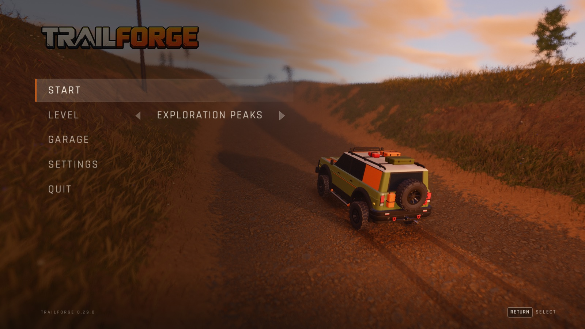
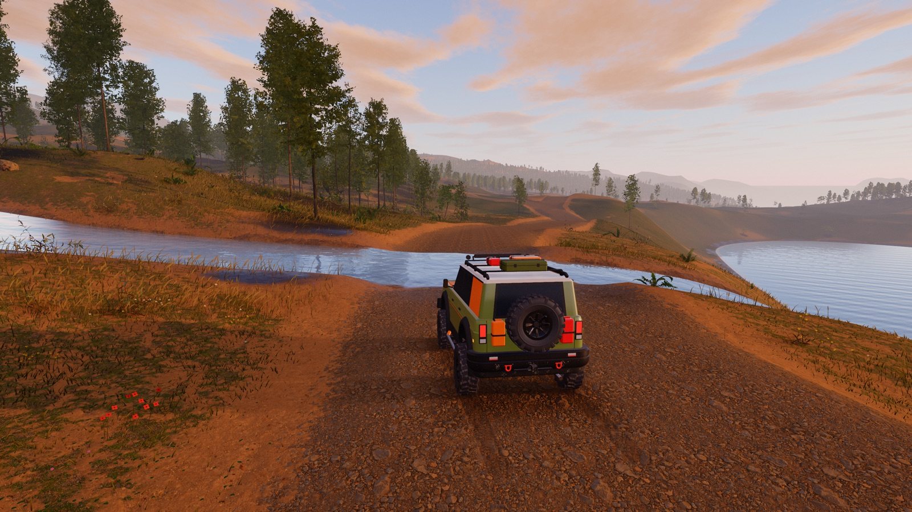
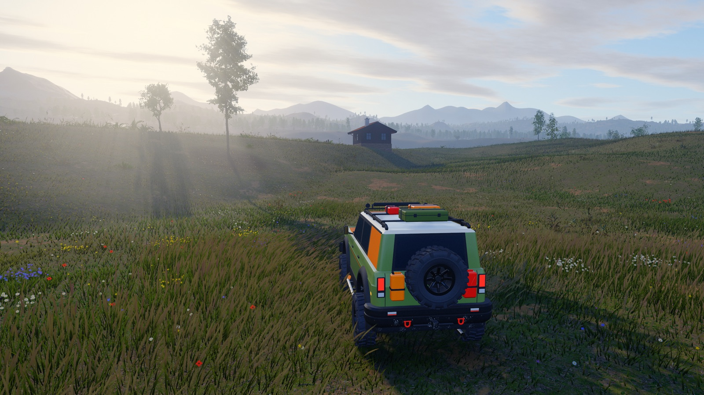

# TrailForge — driving simulator prototype

TrailForge is a driving simulator prototype on a small custom C++20 engine: SDL3 (window, input, gamepad), SDL GPU
(Metal on macOS) with one HLSL shader source, Jolt Physics (`VehicleConstraint` + `WheeledVehicleController`), Dear
ImGui (diagnostics), GLM and miniaudio (device and WAV I/O; the mixer is our own). It covers off-road trails in an
open world, a circuit with lap timing, a handling track with drift scoring, and tire sets with temperature. The focus
is believable vehicle behavior: mass, suspension travel, wheelspin, grip at the limit, wheel lift, rocks and climbs.



| | |
|---|---|
|  |  |

## Features

- **Vehicles:** a gasoline SUV, a dual-motor electric SUV and a tube-frame desert patrol buggy, defined as data
  (`assets/vehicles/<id>/vehicle.json`); RWD / FWD / AWD / part-time / on-demand drivetrains, low range, diff locks,
  ABS and traction control, tire sets with tire temperature, and a garage for setups.
- **Levels:** a procedural proving ground (surface lanes, ramps, a twister, a mini handling track), Exploration
  Peaks (a 2 km open world with roads, trails, forests, a village and 13 points of interest, streamed height-field
  tiles) and Suncoast Raceway (a circuit traced from OpenStreetMap and DEM data) with lap and sector timing.
- **Rendering:** PBR, cascaded shadows, a time of day that drives the sun, sky, fog and ambient light, HDR with
  bloom and post effects, instanced grass and trees with LOD, CC0 photo-scanned ground materials and level models,
  cosmetic tire marks and wheel spray.
- **Audio:** recorded and synthesized sounds driven only by simulation data (rpm, load, wheel contacts, impacts).
- **Tooling:** headless physics tests (CTest), the `trailforge_probe` measurement tool and a scenario mode that
  drives the real window through the SDL event queue for end-to-end checks.

What is simplified or not simulated is listed honestly in [Physics simplifications](docs/physics.md).

## Platforms

Only macOS on Apple Silicon (Metal) has been run. Windows x64 and Linux x64 build and pass the headless tests in
GitHub Actions, but have never been run on real hardware. Details: [Building and running](docs/building.md#platforms).

## Quick start (macOS)

Prerequisites: Xcode Command Line Tools with the Metal toolchain, CMake ≥ 3.24, Ninja and Git LFS
(`brew install cmake ninja git-lfs`, then `git lfs install`). Run `git lfs pull` after cloning (terrain textures and
level models). The first configure downloads the pinned dependencies, so it needs internet access.

```sh
cmake --preset release
cmake --build --preset release
./build/release/trailforge                  # or: --level exploration_peaks
ctest --preset release                      # headless tests
```

Other presets (`debug`, `headless`, Windows, Linux), the app bundle, packaging and command-line options:
[Building and running](docs/building.md). Ad-hoc signed macOS builds are on the GitHub releases page; open the app
with right-click → Open or `xattr -dr com.apple.quarantine TrailForge.app`.

## Controls

| Action | Keyboard | Gamepad |
|---|---|---|
| Throttle / brake (stopped: release S and press again for reverse) | W / S (or ↑ / ↓) | RT / LT |
| Steering | A / D (or ← / →) | left stick |
| Handbrake | Space | A (South) |
| Low range / transfer case (2H → 4H → 4L) | L / V | Y / D-pad left |
| ABS / traction control / diff locks | B / T / X | D-pad up / right / down |
| Camera: follow → close follow → hood → free | C | RB |
| Map | M | LB |
| Reset vehicle | R | Back / View |
| Headlights | H | — |
| Pause menu | Escape | Start / Menu |
| Diagnostics / graphics / audio panels | F1 / F2 / F3 | — |

The full table, the cameras and the menus: [Controls](docs/controls.md). No gamepad has been tested by a person yet.

## Documentation

The detailed documentation is in [docs/](docs/README.md): [building](docs/building.md),
[controls](docs/controls.md), [architecture](docs/architecture.md), [vehicles](docs/vehicles.md),
[vehicle data format](docs/vehicle-format.md), [levels](docs/levels.md), [rendering](docs/rendering.md),
[audio](docs/audio.md), [physics simplifications](docs/physics.md), [testing and diagnostics](docs/testing.md)
(including the scenario mode reference) and the [roadmap](docs/roadmap.md). Release notes are in
[docs/releases/](docs/releases/), the development log in [devlog/](devlog/).

## Licences and credits

Vehicles, the proving ground, the sky and the grass are procedural. External assets are redistributable: sounds
(`assets/audio/CREDITS.md`), CC0 Poly Haven ground and building materials (`assets/textures/CREDITS.md`), CC0 Poly
Haven level models (`assets/models/CREDITS.md`), the Rajdhani font (OFL, `assets/fonts/`), and the Suncoast Raceway
source data (OpenStreetMap, ODbL, and the Copernicus DEM, `assets/levels/suncoast_raceway/CREDITS.md`). Details:
[Assets and licences](docs/README.md#assets-and-licences).
